# Enterprise Multi-Channel E-Commerce & Fairytales SMM Architecture

Welcome to your unified business consulting and operational command center. This system establishes a dual-engine enterprise designed for rapid scale, high operational resilience, and diversified revenue streams:

1. **The Multi-Channel E-Commerce Engine**: Maximizing market share across Tier-1 retail platforms (Amazon FBA/FBM/SFP & Vendor Central, TikTok Shop, Temu, B&Q) + Direct-to-Consumer (DTC) + B2B Wholesale Desk.
2. **Fairytales SMM Agency Engine**: A high-impact social media marketing agency, influencer network, and UGC production studio powering in-house brand sales and servicing external enterprise clients.

---

## 🏛 Specialized Agent Advisory Roster

| Agent Name | Operational Role | Key Responsibilities |
| :--- | :--- | :--- |
| **`marketplace_specialist`** | Chief Marketplace Operations Officer | Amazon (FBA, FBM, SFP, Vendor Central), TikTok Shop, Temu (Semi-Managed), B&Q (Mirakl). Listing optimization, Buy Box, PPC, and platform compliance. |
| **`fairytales_smm_director`** | Managing Director, Fairytales SMM | Influencer/celebrity matchmaking, UGC creator pipelines, Spark/Meta ad whitelisting, agency packaging, and client acquisition. |
| **`wholesale_desk_manager`** | Head of B2B Wholesale & Trade Accounts | Trade portal setup, pricing matrix (MSRP/MAP/WSP), line sheets, buyer outreach, credit terms (Net 30/60), and retailer onboarding. |
| **`dtc_and_systems_architect`** | DTC & ERP Systems Lead | Shopify/Website conversion optimization, OMS/ERP inventory synchronization (Linnworks/ChannelEngine), and Klaviyo retention. |

---

## 🌐 Internal Executive Management Portal (Password Protected)
- **[Launch Executive Management Portal (HTML)](file:///Users/mamun/Documents/Business%20Consultant/portal/index.html)**: **The Complete Password-Protected Internal Management Information & Decision System**. Features a modern executive interface (Default PIN: `adov2026`), 11 interactive modules covering the entire project lifecycle from planning to go-live, real-time KPI ribbon, interactive Placement Fee & Bed Occupancy Simulator, 9-month Implementation Checklist Tracker with local persistence, Document Vault with 20 direct downloads, and a searchable 38-term plain-English Abbreviations Glossary.
  - **Local Web Server Launcher:** Run `./serve_portal.py` in your terminal to serve on `http://localhost:8080`.

## 🗺 Operational Playbooks & Master Document Directory

- **[Amazon Mastery Playbook](file:///Users/mamun/Documents/Business%20Consultant/playbooks/01_amazon_mastery.md)**: Strategies for FBA, FBM, SFP (1-2 day delivery guarantee), Vendor Central (1P PO management & chargeback defense), Brand Registry, and A+ content.
- **[Emerging Marketplaces Playbook](file:///Users/mamun/Documents/Business%20Consultant/playbooks/02_emerging_marketplaces.md)**: TikTok Shop affiliate network, Temu Local-to-Local (Semi-Managed) onboarding, and B&Q / Mirakl UK marketplace deployment.
- **[DTC & Tech Stack Synchronization](file:///Users/mamun/Documents/Business%20Consultant/playbooks/03_dtc_and_tech_stack.md)**: Multi-channel inventory routing, preventing stockouts, automated order routing, and Shopify Plus conversion funnels.
- **[B2B Wholesale Trade Desk Blueprint](file:///Users/mamun/Documents/Business%20Consultant/playbooks/04_wholesale_trade_desk.md)**: Catalog line sheets, wholesale pricing formulas, B2B trade platforms (Faire/Ankorstore/Direct), and buyer outreach cadences.
- **[Fairytales SMM Agency Blueprint](file:///Users/mamun/Documents/Business%20Consultant/playbooks/05_fairytales_smm_agency.md)**: Agency service tiers, Creator & Celebrity recruitment funnel, high-converting UGC script formulas, and client retainer pitches.
- **[ADOV Care Group CQC Registration Master Report (PDF)](file:///Users/mamun/Documents/Business%20Consultant/ADOV_Care_Group_CQC_Registration_Master_Report.pdf)** | **[(Word DOCX)](file:///Users/mamun/Documents/Business%20Consultant/ADOV_Care_Group_CQC_Registration_Master_Report.docx)**: **The Definitive Academic Monograph & Operational Dossier (Monograph No. 2026-MG-05)**. Formatted in Oxford/Cambridge scholarly monograph styling (pure white `#FFFFFF` background, printer-ink friendly hairline rules, zero overlapping text, exactly 10 pages). Detailed 6-phase operational roadmap from Day 1 pre-application to final certificate issuance and Luton Council DPS activation under the Health and Social Care Act 2008 and new CQC Single Assessment Framework. Features 4 clean vector schematics (Housing vs Care Separation, CQC Single Assessment Governance, 6-Phase Timeline with Section 28(3) Fast-Track, and Pro-Forma Cashflow Model), complete DBS/GP protocols, 4-part Statement of Purpose (Reg 12), Reg 13 financial viability (£150k buffer, 3-year P&L: £1.331M revenue, £541k EBITDA), Registered Manager Level 5 interview preparation (5 statutory clinical scenarios), physical inspection specifications for 78 & 80 Marston Gardens, the **Section 28(3) statutory waiver letter** cutting 28 days off registration, and Luton Council ProContract DPS (AT1115) onboarding.
- **[ADOV Care Group Strategic Campus Location Appraisal (PDF)](file:///Users/mamun/Documents/Business%20Consultant/ADOV_Care_Group_Campus_Strategy_Appraisal.pdf)** | **[(Word DOCX)](file:///Users/mamun/Documents/Business%20Consultant/ADOV_Care_Group_Campus_Strategy_Appraisal.docx)**: **The Definitive Academic Monograph & Board Decision Dossier (Monograph No. 2026-MG-04)**. Formatted in Oxford/Cambridge scholarly monograph styling (pure white `#FFFFFF` background, printer-ink friendly hairline rules, zero overlapping text, exactly 10 pages). Definitive comparative audit evaluating **Scenario A (Unified 8-Bed Campus at 78 & 80 + Family Relocation to 82 under AST)** vs. **Scenario B (Split Disconnected Properties at 78 & 82 + Family Remains at 80)**. Features 4 clean vector schematics (Architectural Site Plan & Swept Paths, Operational Workforce Rota Model, HMRC Tax-Neutral Rent Arbitrage Flowchart, and Financial EBITDA Waterfall), full multi-criteria decision matrices, staffing rotas, CapEx wetroom optimization, HMRC Benefit in Kind (BIK) neutrality (s.105/106 ITEPA 2003), 3-year P&L waterfall (+£78,000/yr EBITDA advantage), and Luton Local Plan Policy LLP32 highways analysis.
- **[ADOV Care Group Operational Profit & Loss (P&L) & Financial Viability Model (PDF)](file:///Users/mamun/Documents/Business%20Consultant/ADOV_Care_Group_Operational_PnL_and_Financial_Viability_Model.pdf)** | **[(Word DOCX)](file:///Users/mamun/Documents/Business%20Consultant/ADOV_Care_Group_Operational_PnL_and_Financial_Viability_Model.docx)**: Forensic GAAP management accounts, itemized direct care payroll (12 FTE Support Workers, 15% Employer NI, 3% Pension), 11 granular overhead categories, 3-scenario operational stress testing (Worst-Case 62.5% vs Base-Case 87.5% vs Best-Case 100%), 3.8-bed break-even threshold (52.5% Margin of Safety), and consolidated group cash generation (£438,392/yr).
- **[ADOV Care Group 4-Options Strategic Comparison Report (PDF)](file:///Users/mamun/Documents/Business%20Consultant/ADOV_Care_Group_4_Options_Strategic_Comparison_Report.pdf)** | **[(Word DOCX)](file:///Users/mamun/Documents/Business%20Consultant/ADOV_Care_Group_4_Options_Strategic_Comparison_Report.docx)**: In-depth forensic appraisal contrasting Child Care (EBD), Elderly Residential (C2), Mental Health (S117), and Adult Autism/LD Supported Living across 7 dimensions (Profitability, Operations, Approvals, Neighbourhoods, HR, Effort/Productivity, and Scalability).
- **[ADOV Care Group CQC Requirements & Statutory Fulfillment Guide (PDF)](file:///Users/mamun/Documents/Business%20Consultant/ADOV_Care_Group_CQC_Requirements_and_Fulfillment_Guide.pdf)** | **[(Word DOCX)](file:///Users/mamun/Documents/Business%20Consultant/ADOV_Care_Group_CQC_Requirements_and_Fulfillment_Guide.docx)**: Master statutory manual covering the 10 compliance pillars, 24 mandatory audit criteria, clinical interview defense, and Section 28(3) fast-track waiver.
- **[ADOV Care Group Resident Intake Pathway SOP (PDF)](file:///Users/mamun/Documents/Business%20Consultant/ADOV_Care_Group_Resident_Intake_Pathway_SOP.pdf)** | **[(Word DOCX)](file:///Users/mamun/Documents/Business%20Consultant/ADOV_Care_Group_Resident_Intake_Pathway_SOP.docx)**: Definitive operational manual for Directors and Registered Managers detailing the 8 core strategies from proactive commissioning to 90-day stabilization.
- **[ADOV Care Group CQC Provider Application Questions Dossier (PDF)](file:///Users/mamun/Documents/Business%20Consultant/ADOV_Care_Group_CQC_Provider_Application_Questions_Dossier.pdf)** | **[(Word DOCX)](file:///Users/mamun/Documents/Business%20Consultant/ADOV_Care_Group_CQC_Provider_Application_Questions_Dossier.docx)**: Complete 42-question statutory dossier covering Sections 1 through 9 of the official CQC Provider Application.
- **[ADOV Care Group Luxury Private Project Prospectus (PDF)](file:///Users/mamun/Documents/Business%20Consultant/ADOV_Care_Group_Private_Project_Prospectus.pdf)** | **[(Word DOCX)](file:///Users/mamun/Documents/Business%20Consultant/ADOV_Care_Group_Private_Project_Prospectus.docx)**: **The Definitive 12-Page Luxury Brochure & Private Investment Prospectus**. Planned by **AbdullahMamun.com** for **FAIRYTALES GROUP** (Trading Name of Mamun Limited) and **ADOV LIMITED**. Features luxury Midnight Navy & Gold brochure styling, dedicated Table of Contents, 4-sector investment matrix, Dual Section 192 CLPUD planning immunity under TCPA 1990 s.55(2)(f), HoldCo/PropCo/OpCo corporate structuring, HMRC tax-neutral rent-swap for 82 Marston Gardens (BIK NIL), sanitary wetroom optimization (saving £42,000 CapEx), £150,000 turnkey budget, 3-year P&L (£1,043,328 revenue, £408,328 EBITDA, £523,328 group cashflow), CQC Single Assessment registration, Luton Borough Council ProContract DPS (AT1115), 6-stage zero-void placement protocol, and luxury front/back covers.

### 📂 Print-Ready Statutory & Operational Document Packs (Ready for Execution)
- **[1. Master Statutory Document Checklist (PDF)](file:///Users/mamun/Documents/Business%20Consultant/ADOV_Care_Group_Master_Document_Checklist.pdf)** | **[(Word DOCX)](file:///Users/mamun/Documents/Business%20Consultant/ADOV_Care_Group_Master_Document_Checklist.docx)**: Complete 5-domain checklist and step-by-step submission timeline covering corporate, planning, life safety, CQC, and commissioning filings.
- **[2. Corporate Legal & Intercompany Lease Pack (PDF)](file:///Users/mamun/Documents/Business%20Consultant/ADOV_Care_Group_Corporate_Legal_Pack.pdf)** | **[(Word DOCX)](file:///Users/mamun/Documents/Business%20Consultant/ADOV_Care_Group_Corporate_Legal_Pack.docx)**: Complete execution contracts: 10-Year FRI Lease for 78 (£65k/yr), 10-Year FRI Lease for 80 (£50k/yr), AST Tenancy for 82 (£1,500/mo, BIK NIL), and Group Board Resolutions.
- **[3. Section 192 Planning Justification Statement (PDF)](file:///Users/mamun/Documents/Business%20Consultant/ADOV_Care_Group_Section_192_Planning_Statement.pdf)** | **[(Word DOCX)](file:///Users/mamun/Documents/Business%20Consultant/ADOV_Care_Group_Section_192_Planning_Statement.docx)**: Formal submission statement for Luton Borough Council for Class C3(b) certificate of lawfulness under TCPA 1990 s.55(2)(f) and Policy LLP32.
- **[4. CQC Statement of Purpose (SoP) Pack (PDF)](file:///Users/mamun/Documents/Business%20Consultant/ADOV_Care_Group_CQC_Statement_of_Purpose.pdf)** | **[(Word DOCX)](file:///Users/mamun/Documents/Business%20Consultant/ADOV_Care_Group_CQC_Statement_of_Purpose.docx)**: Official CQC Statement of Purpose under Regulation 12 covering aims, 78 & 80 locations, Registered Manager Level 5 requirements, and 34 Quality Statements.
- **[5. Supported Living Tenancy & Care Pack (PDF)](file:///Users/mamun/Documents/Business%20Consultant/ADOV_Care_Group_Supported_Living_Tenancy_Pack.pdf)** | **[(Word DOCX)](file:///Users/mamun/Documents/Business%20Consultant/ADOV_Care_Group_Supported_Living_Tenancy_Pack.docx)**: Resident Assured Shorthold Tenancy Agreement, Separate Care & Support Agreement, and £350/week Supported Exempt Accommodation Housing Benefit claim letter.

- **[ADOV Care Group Master Government Project Report (PDF)](file:///Users/mamun/Documents/Business%20Consultant/ADOV_Care_Group_Government_Project_Report.pdf)** | **[(Word DOCX)](file:///Users/mamun/Documents/Business%20Consultant/ADOV_Care_Group_Government_Project_Report.docx)**: **Statutory Commissioning Reference**. 10-chapter technical report integrating subagent findings.
- **[Healthcare & Supported Living Master Blueprint](file:///Users/mamun/Documents/Business%20Consultant/playbooks/care_home_supported_living_master_blueprint.md)**: Conversion blueprint for 78 & 82 Marston Gardens, Luton (LU2 7DY) into CQC/Luton Council/NHS BLMK care facilities (PropCo/OpCo, C3b/C2 planning, L1 fire safety, BoQ, and 40-week execution plan).
- **[ADOV Care Group Photographic Campus Masterplan (PDF)](file:///Users/mamun/Documents/Business%20Consultant/ADOV_Care_Group_Photographic_Campus_Masterplan.pdf)** | **[(Word DOCX)](file:///Users/mamun/Documents/Business%20Consultant/ADOV_Care_Group_Photographic_Campus_Masterplan.docx)**: Direct architectural analysis of 78 & 80 Marston Gardens' twin driveways (8 off-street cars + 2 garages), minimal setup CapEx (£150k), dual C3(b) planning certainty, and £523k/yr net group cash flow.
- **[ADOV Care Group Unified Campus (78 & 80) Master Report (PDF)](file:///Users/mamun/Documents/Business%20Consultant/ADOV_Care_Group_Unified_Campus_78_80_Report.pdf)** | **[(Word DOCX)](file:///Users/mamun/Documents/Business%20Consultant/ADOV_Care_Group_Unified_Campus_78_80_Report.docx)**: The game-changing masterplan combining 78 & 80 Marston Gardens into an 8-bed unified care campus with £523k/yr net group cash flow, while moving your personal residence to 82 Marston Gardens with full tax neutrality.
- **[ADOV Care Group Final Recommendation Report (PDF)](file:///Users/mamun/Documents/Business%20Consultant/ADOV_Care_Group_Final_Recommendation_Report.pdf)** | **[(Word DOCX)](file:///Users/mamun/Documents/Business%20Consultant/ADOV_Care_Group_Final_Recommendation_Report.docx)**: The definitive expert consultant masterplan: 78 Marston Gdns Autism Supported Living, living at 82 Marston Gdns (HMRC BIK/ATED), 5-year financial cash flow, and 30-week execution schedule.
- **[ADOV Care Group Child Care Feasibility Report (PDF)](file:///Users/mamun/Documents/Business%20Consultant/ADOV_Care_Group_Child_Care_Feasibility_Report.pdf)** | **[(Word DOCX)](file:///Users/mamun/Documents/Business%20Consultant/ADOV_Care_Group_Child_Care_Feasibility_Report.docx)**: In-depth 4-option appraisal, cost-benefit analysis, Ofsted licensing, and planning case law for 78 & 82 Marston Gardens.
- **[ADOV Care Group 4-Sector Master Feasibility Report (PDF)](file:///Users/mamun/Documents/Business%20Consultant/ADOV_Care_Group_4_Sector_Master_Feasibility_Report.pdf)** | **[(Word DOCX)](file:///Users/mamun/Documents/Business%20Consultant/ADOV_Care_Group_4_Sector_Master_Feasibility_Report.docx)**: Definitive comparison of Child Care vs Elderly Care vs Mental Health vs Autism, plus strategic analysis of moving to 82 Marston Gdns and operating 78 Marston Gdns (HMRC BIK, ATED, and on-site executive governance).

---

## ⚡ Execution Roadmap: 90-Day Sprint

```mermaid
flowchart LR
    A["Phase 1: Foundation (Days 1-30)"] --> B["Phase 2: Channel Expansion (Days 31-60)"]
    B --> C["Phase 3: Agency & B2B Scale (Days 61-90)"]
    
    subgraph A["Phase 1: Foundation"]
        A1["OMS/ERP Integration"]
        A2["Amazon FBA/FBM Audit & SFP Prep"]
        A3["Fairytales SMM Brand Kit & Rate Cards"]
    end
    
    subgraph B["Phase 2: Channel Expansion"]
        B1["TikTok Shop Open/Target Collabs"]
        B2["Temu Semi-Managed & B&Q Mirakl Launch"]
        B3["First 20 UGC Creator Seedings"]
    end
    
    subgraph C["Phase 3: Agency & B2B Scale"]
        C1["Open Wholesale B2B Desk"]
        C2["First 3 External Agency Retainer Clients"]
        C3["Omni-Channel Spark & Meta Ad Scaling"]
    end
```

## Executive Management Information System (MIS) Update (October 2026)
- **Portal Access:** `portal/index.html` (Passcode: `adov2026`) or `python3 serve_portal.py`
- **Strategic Comparison Model:** Scenario A (Unified 78 & 80, Director to 82) vs. Scenario B (Split Sites) with 10-criteria evaluation, £70,200/yr night staffing savings, £87,000 CapEx savings, and tax arbitrage.
- **Physical Topology Corrections:** House 82 confirmed as semi-detached (paired with 84); House 78 confirmed as semi-detached with adjoining property (76) incorporating Approved Document E acoustic insulation (>55dB). All 3 houses feature identical 4-car side driveways, detached lock-up garages, and 24.5m deep gardens (500m²+ combined outdoor sanctuary).
- **CQC Approval Roadmap:** 8-stage statutory process map (SVG) and comprehensive step-by-step operating guide including Section 28(3) fast-track waiver.
- **Financial Models:** Itemized monthly running cost model by category (£53,018/mo at full 8-bed capacity) and 1-year operational cashflow forecasting (Months 1–12) reaching break-even at Month 8.
