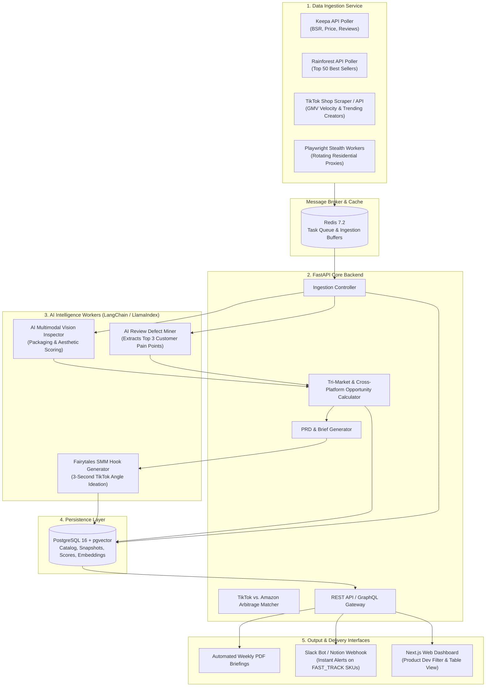
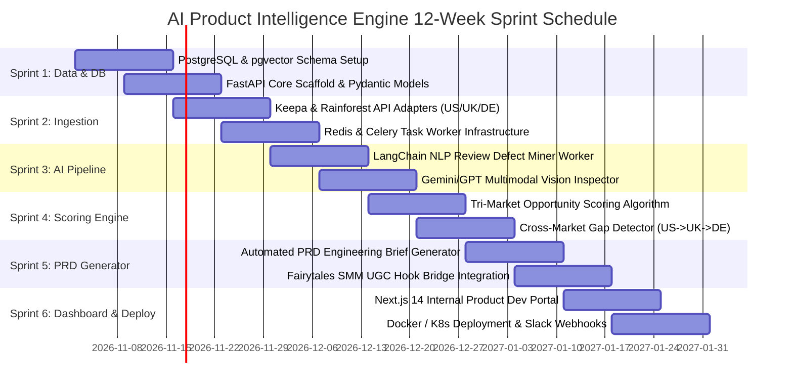

# ENTERPRISE AI PRODUCT INTELLIGENCE SYSTEM: TECHNICAL ARCHITECTURE & DEVELOPER IMPLEMENTATION PLAN

**Target Audience:** Lead Software Architects, Data Engineers & Full-Stack Developers  
**System Name:** Transatlantic E-Commerce AI Discovery & Opportunity Engine (TEA-DOE)  
**Operating Entity:** Fairytales SMM & Multi-Channel E-Commerce Group  
**Headquarters:** High Heath Farm, Whitwell Road, Codicote, Hertfordshire, SG4 8SZ  
**Lead Advisory Unit:** `marketplace_specialist` & Systems Architecture Lead  

---

## 1. System Vision & Engineering Objectives

The system is designed as an autonomous, AI-powered intelligence platform that continuously tracks Category-Wise Top 50 products across **Amazon US (`.com`)**, **Amazon UK (`.co.uk`)**, and **Amazon Germany (`.de`)** in six strategic focus niches:
1. Pet Accessories
2. Mobile Accessories
3. Yoga Accessories
4. Fitness Accessories
5. Kitchen Accessories
6. Household Accessories

### Core Engineering Requirements:
1. **Automated Multi-Source Extraction**: Robust polling of 50 products/category/week across 3 marketplaces (18 categories total = 900 active products monitored weekly).
2. **AI-Driven Customer Defect Mining**: Ingesting 1-star to 3-star customer reviews to pinpoint recurring engineering defects and unmet customer needs.
3. **Multimodal Computer Vision Analysis**: Auditing product imagery, packaging aesthetics, and feature callouts.
4. **Tri-Market Arbitrage Scoring**: Algorithmic scoring identifying US breakout products with low competition in the UK and Germany.
5. **Automated PRD (Product Requirements Document) Synthesis**: Generating structured engineering briefs for the product development team.

---

## 2. Technical Stack & Component Topology

```
+----------------------------------------------------------------------------------------------------+
|                                    ENTERPRISE SYSTEM TOPOLOGY                                      |
+--------------------------+-----------------------+-------------------------------------------------+
| Component Layer          | Technology Selected   | Rationale / Purpose                             |
+--------------------------+-----------------------+-------------------------------------------------+
| **Primary Ingestion API**| Keepa Data API        | Real-time & 90-day historical BSR, price &      |
|                          | + Rainforest API      | review velocity; native US, UK, DE locales.     |
+--------------------------+-----------------------+-------------------------------------------------+
| **Fallback Scraper**     | Python + Playwright   | Headless stealth scraper with rotating          |
|                          | (Residential Proxies) | proxies (Bright Data / Oxylabs) for edge cases. |
+--------------------------+-----------------------+-------------------------------------------------+
| **Backend Core**         | Python (FastAPI)      | High-performance asynchronous REST API, async IO|
|                          | / Pydantic v2         | validation, native integration with AI toolsets.|
+--------------------------+-----------------------+-------------------------------------------------+
| **Task Queue & Scheduler**| Celery + Redis        | Distributed task queue for asynchronous batch   |
|                          | (or Temporal.io)      | ingestion, AI sentiment analysis, and cron jobs.|
+--------------------------+-----------------------+-------------------------------------------------+
| **Relational Database**  | PostgreSQL 16+        | ACID-compliant storage for catalogs, snapshots, |
|                          | with pgvector         | opportunity scores, and semantic embeddings.    |
+--------------------------+-----------------------+-------------------------------------------------+
| **AI / LLM Orchestration**| LangChain / LlamaIndex| Review defect mining, multimodal vision audits, |
|                          | + Gemini 1.5 Pro / GPT-4o| and automated PRD generation.                |
+--------------------------+-----------------------+-------------------------------------------------+
| **Developer UI Dashboard**| Next.js 14 + Tailwind | Internal portal for Product Dev, filtering by   |
|                          | + Tremor UI           | opportunity score, category, and tri-market gap.|
+--------------------------+-----------------------+-------------------------------------------------+
| **DevOps & Deployment**  | Docker + Kubernetes   | Containerized microservices, horizontal worker  |
|                          | / AWS ECS Fargate     | auto-scaling, GitHub Actions CI/CD pipeline.    |
+--------------------------+-----------------------+-------------------------------------------------+
```

---

## 3. High-Level Architecture (C4 Container View)



---

## 4. AI Pipeline Specifications & Prompt Engineering

### Pipeline A: The AI Customer Defect & Review Miner
Most products fail because they clone existing flaws. This worker extracts 100 recent critical reviews (1–3 stars) from Amazon US/UK/DE to formulate engineering solutions.

```python
# System Prompt for Review Defect Mining Worker
SYSTEM_PROMPT = """
You are the Principal Quality & Reliability Engineer for our Product Development Team.
Analyze the following customer negative reviews for an Amazon best-seller product.
Identify:
1. Top 3 recurring mechanical, material, or usability failures.
2. Root causes of customer dissatisfaction.
3. Specific engineering improvements to eliminate these defects in our Version 2.0 product.
4. Estimated BOM (Bill of Materials) cost impact of these fixes.

Format your output strictly as valid JSON adhering to the ProductDefectAnalysis schema.
"""
```

### Pipeline B: Multimodal Vision & Aesthetic Quality Inspector
Evaluates hero listing images, packaging, and unboxing appeal against modern DTC aesthetics.

```python
# System Prompt for Vision Analysis Worker
VISION_PROMPT = """
Analyze the attached product packaging and lifestyle imagery.
Evaluate:
1. Aesthetic Appeal (1-10): Is it dated, generic, or premium?
2. Giftability Score (1-10): Does it function as a high-margin holiday/birthday gift?
3. SMM & UGC Fit (1-10): How easily can a TikTok creator demonstrate this in 3 seconds?
4. Packaging Redesign Recommendation: Exactly how should our Codicote studio redesign the unboxing box?
"""
```

---

## 5. 12-Week Agile Development Roadmap (6 Sprints)



---

### Sprint-by-Sprint Deliverables:

- **Sprint 1 (Weeks 1–2): Database Architecture & Backend Scaffold**
  - Configure PostgreSQL 16 with `pgvector` extension.
  - Setup FastAPI application structure, Alembic database migrations, and Pydantic v2 schemas.
  - Implement authentication and API rate limiting.

- **Sprint 2 (Weeks 3–4): Ingestion Orchestration Engine**
  - Build Keepa Data API client with token rate-limiting pool across US (domain 1), UK (domain 2), and DE (domain 3).
  - Configure Celery task worker scheduled every Monday at 02:00 AM UTC.
  - Store weekly snapshots with historical BSR and price change deltas.

- **Sprint 3 (Weeks 5–6): AI Review Defect Mining & Vision Processing**
  - Deploy asynchronous LLM workers analyzing negative reviews.
  - Integrate Vision LLM parsing hero images for aesthetic scoring.
  - Vectorize product titles and feature bullets to detect duplicate/white-label clones.

- **Sprint 4 (Weeks 7–8): Tri-Market Opportunity Scoring Engine**
  - Implement mathematical 0–100 Opportunity Scoring formula.
  - Create the Transatlantic Gap detector highlighting high-velocity US items absent from UK/Germany.
  - Expose filtered REST API endpoints (`/api/v1/opportunities?verdict=FAST_TRACK`).

- **Sprint 5 (Weeks 9–10): Automated PRD & Fairytales SMM Bridge**
  - Implement automatic generation of Product Requirements Documents (BOM estimates, target price, defect fixes).
  - Bridge winning SKUs directly to `fairytales_smm_director` for immediate UGC 3-second hook scripting.

- **Sprint 6 (Weeks 11–12): Internal Web Dashboard, Slack Bot & CI/CD**
  - Build Next.js 14 web portal for internal product managers and sourcing agents.
  - Configure automated Slack channel alerts for `FAST_TRACK` notifications.
  - Package Docker containers, configure Helm charts, and setup GitHub Actions CI/CD.
