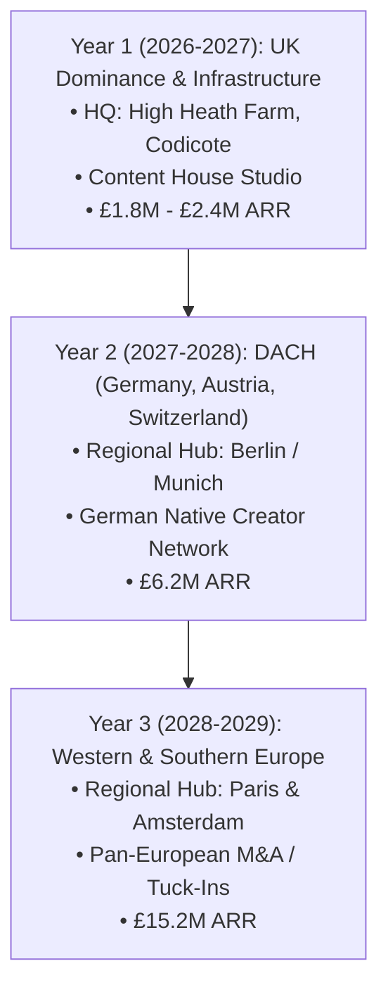

# FAIRYTALES SMM: 3-YEAR EXECUTIVE BUSINESS PLAN & PAN-EUROPEAN EXPANSION STRATEGY (2026–2029)

**Corporate Headquarters:**  
Fairytales SMM  
High Heath Farm, Whitwell Road, Codicote, Hertfordshire, SG4 8SZ, United Kingdom  

**Prepared For:** Chief Executive Officer (CEO) & Managing Partner  
**Lead Advisory Unit:** `strategic_management_director` (Chief Strategy Officer)  
**Classification:** STRICTLY CONFIDENTIAL // BOARDROOM PRESENTATION  

---

## 1. Executive Summary & Corporate Vision

**Fairytales SMM** is positioned to become Europe’s premier next-generation social media marketing agency, creator studio, and social commerce accelerator. 

Operating from our headquarters at **High Heath Farm, Codicote, SG4 8SZ**, Fairytales SMM eliminates the divide between creative branding and hard-nosed e-commerce performance. By integrating performance UGC production, celebrity and creator ambassadorships, and proprietary paid amplification (TikTok Spark Ads & Meta Partnership Ads), the agency serves a dual mission:
1. **The Internal Brand Engine**: Accelerating organic and paid revenue for our proprietary multi-channel e-commerce product lines across Amazon, TikTok Shop, Temu, B&Q, DTC, and Wholesale.
2. **The Multinational Agency Engine**: Providing enterprise-grade creator marketing, UGC production, and social commerce growth retainers to leading global brands across the United Kingdom, DACH, France, and greater Europe.

### 3-Year Enterprise Target (Fiscal 2026 – 2029):
- **Annual Recurring Revenue (ARR)**: Scale from UK launch foundation (£1.5M ARR) to **£15.2M ARR** across 4 European operating hubs.
- **Active Enterprise Client Roster**: 75+ retainers across UK, Germany, France, and Benelux.
- **Creator Network Capacity**: Over 2,500 vetted European creators spanning 5 languages (English, German, French, Italian, Spanish).

---

## 2. Market Opportunity & Competitive Differentiation

```
+-------------------------------------------------------------------------------------------------------+
|                                    THE EUROPEAN MARKET SHIFT                                          |
+-------------------------------+----------------------------------+------------------------------------+
| Legacy European Agencies      | Pure-Play UGC Marketplaces       | FAIRYTALES SMM ADVANTAGE           |
+-------------------------------+----------------------------------+------------------------------------+
| • Slow, bloated retainers     | • Low quality, zero strategy     | • 7-Day rapid creative turnaround  |
| • Focus on vanity impressions | • No paid ad integration         | • Proven in-house e-commerce roots |
| • Zero accountability for ROI | • High churn, unvetted creators  | • Full-funnel Spark & Meta ads     |
| • Disconnected from e-comm    | • Isolated from retail channels  | • Native European language hubs    |
+-------------------------------+----------------------------------+------------------------------------+
```

---

## 3. 3-Year Pan-European Multinational Expansion Roadmap

To establish Fairytales SMM as a multinational power across Europe within 36 months, expansion is phased through systematic market entries, regulatory compliance, and regional hub infrastructure:



---

### Phase 1: Months 1–12 (Foundation & UK Market Leadership)
- **Headquarters & Production Campus**:
  - Establish the **High Heath Farm Campus (Codicote, SG4 8SZ)** as the primary creative testing studio and executive command center.
  - Build specialized indoor studio sets (Modern Kitchen, Luxury Living, Tech/Office, Beauty Vanity) to enable rapid 48-hour in-house UGC filming.
- **Core Market Focus**: United Kingdom e-commerce brands, high-growth DTC startups, and TikTok Shop UK power sellers.
- **Financial Target**: £150,000 – £200,000 monthly run-rate (£1.8M – £2.4M ARR); 18–25 active retainer clients.
- **Infrastructure**: Automated client billing, standardized creator contracts, and proprietary 100-point creator vetting scorecard.

---

### Phase 2: Months 13–24 (DACH Expansion: Germany, Austria, Switzerland)
Germany is the largest e-commerce economy in mainland Europe, with massive TikTok and Meta consumer adoption, yet local agencies lag behind UK/US UGC performance standards.
- **Regional Hub**: Establish **Fairytales SMM GmbH** in Berlin or Munich.
- **Talent & Localization**:
  - Hire a bilingual DACH Managing Director and 3 native German-speaking talent scouts.
  - Recruit and vet a roster of 400+ German, Austrian, and Swiss creators.
  - Adapt all creative brief frameworks for German consumer psychology (emphasizing reliability, technical specifications, sustainability, and TÜV/CE certifications).
- **Logistics & Warehousing**: Integrate EU-based 3PL sample fulfillment hub in Frankfurt/Venlo to ship creator PR seeding packs within 24–48 hours across the EU without customs delays.
- **Financial Target**: £500,000 monthly run-rate (£6.0M ARR); 45 active retainers across UK and DACH.

---

### Phase 3: Months 25–36 (Pan-European Dominance: France, Benelux & Southern Europe)
- **Regional Hubs**:
  - **Paris Hub (France)**: Dedicated to European Beauty, Fashion, Fragrance, and Luxury Consumer Goods.
  - **Amsterdam / Dublin Hub**: Corporate enterprise client acquisition, directly interfacing with TikTok EMEA and Meta European HQ teams.
- **Strategic M&A / Tuck-Ins**:
  - Acquire 1–2 boutique local creator agencies in Paris and Milan (£300k–£750k acquisition size) to immediately absorb existing local brand relationships and local creator rosters.
- **Multilingual Campaign Engine**: Capability to launch coordinated single-day product launches across 5 languages simultaneously (EN, DE, FR, IT, ES).
- **Financial Target**: £1.26M monthly run-rate (**£15.2M ARR**); 75+ enterprise retainers across Europe.

---

## 4. Pan-European Regulatory, Tax & Corporate Governance

Expanding across Europe requires rigorous cross-border corporate structuring:

```
+----------------------------------------------------------------------------------------------------+
|                                  CORPORATE & REGULATORY BLUEPRINT                                  |
+--------------------------+-----------------------+-------------------------------------------------+
| Jurisdiction / Domain    | Legal Mechanism       | Operational Implementation                      |
+--------------------------+-----------------------+-------------------------------------------------+
| Corporate Holding Co     | UK Ltd (Codicote, UK) | TopCo holding equity in regional EU operating   |
|                          |                       | subsidiaries (Fairytales GmbH, Fairytales SAS). |
+--------------------------+-----------------------+-------------------------------------------------+
| EU Value Added Tax (VAT) | EU OSS / IOSS Scheme  | Single EU VAT registration handling cross-      |
|                          |                       | border agency services & sample dispatches.     |
+--------------------------+-----------------------+-------------------------------------------------+
| Data Protection & GDPR   | UK & EU GDPR Regs     | Strict creator data privacy, right-to-be-       |
|                          |                       | forgotten compliance on creator CRM databases.  |
+--------------------------+-----------------------+-------------------------------------------------+
| Advertising Standards    | ASA (UK), wettbewerbs-| Mandatory standardized disclosures across       |
|                          | zentrale (DE), ARPP   | platforms (#ad, #werbung, #collaboration).      |
+--------------------------+-----------------------+-------------------------------------------------+
```

---

## 5. 3-Year Pro Forma Financial Model (2026–2029)

| Financial Metric | Year 1 (UK Base) | Year 2 (+ DACH) | Year 3 (Pan-Europe) |
| :--- | :--- | :--- | :--- |
| **Gross Agency Revenue** | **£2,100,000** | **£6,400,000** | **£15,200,000** |
| Creator Payouts & Gifting COGS | £520,000 | £1,600,000 | £3,800,000 |
| Production & Video Editing Team | £380,000 | £1,150,000 | £2,700,000 |
| Software & Infrastructure Stack | £65,000 | £190,000 | £450,000 |
| **Gross Profit Margin** | **£1,135,000 (54.0%)** | **£3,460,000 (54.1%)** | **£8,250,000 (54.3%)** |
| Personnel & Regional Hub Overhead | £480,000 | £1,450,000 | £3,200,000 |
| Marketing & Client Acquisition (CAC) | £150,000 | £420,000 | £950,000 |
| **EBITDA (Net Operating Profit)** | **£505,000 (24.0%)** | **£1,590,000 (24.8%)** | **£4,100,000 (27.0%)** |
