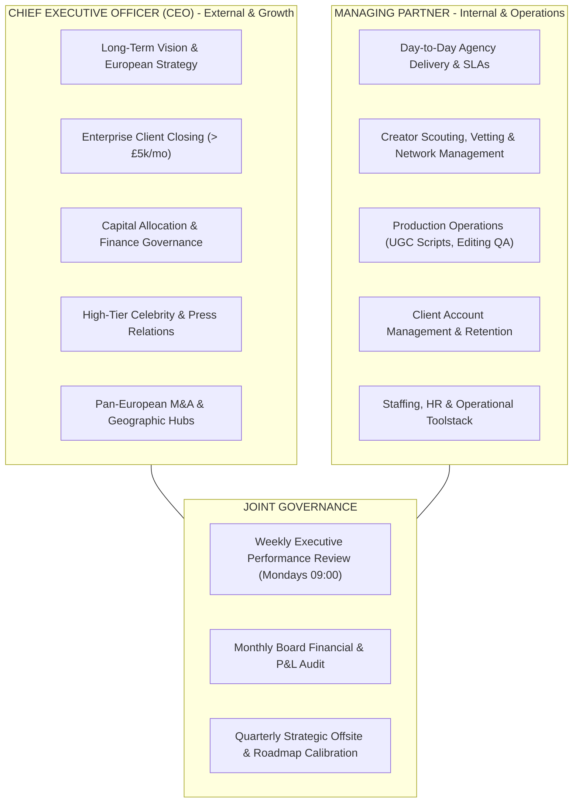

# STANDARD OPERATING PROCEDURES (SOP): EXECUTIVE GOVERNANCE & LEADERSHIP

**Organization:** Fairytales SMM  
**Headquarters:** High Heath Farm, Whitwell Road, Codicote, Hertfordshire, SG4 8SZ  
**Executive Roles:** Chief Executive Officer (CEO) & Managing Partner (COO / Head of Delivery)  
**Effective Date:** Fiscal Year 2026 – 2029  
**Classification:** INTERNAL GOVERNANCE MANUAL  

---

## 1. Executive Roles & Strategic Division of Responsibilities

The leadership team operates as a complementary two-pillar partnership:
- **Chief Executive Officer (CEO)**: Focuses on **External Growth, Enterprise Strategy & Vision**. Owns investor relations, capital allocation, high-ticket enterprise client acquisitions, strategic partnerships, European geographic expansion, and high-level celebrity relationships.
- **Managing Partner (COO / Delivery Lead)**: Focuses on **Internal Execution, Operations & Profitability**. Owns day-to-day campaign delivery, creator network performance, client retention, agency unit economics, talent hiring/management, and process automation.

---

## 2. Standard Operating Procedure: Chief Executive Officer (CEO)

### Purpose:
Drive enterprise valuation, unlock market expansion, and secure strategic multi-channel partnerships.

### Core Responsibilities:
1. **Strategic Vision & Roadmap**: Direct the 3-year European expansion roadmap, ensuring milestones for UK, DACH, and French market entries remain on schedule.
2. **Enterprise Business Development**:
   - Serve as the closing lead on Enterprise retainers (£5,000 to £15,000/month).
   - Conduct C-suite presentations for high-profile multi-channel brands.
3. **Capital Allocation & Banking**:
   - Oversee company treasury, banking facilities, and profit distribution policies.
   - Authorize capital expenditures exceeding £5,000.
4. **Brand Representation & Network**:
   - Act as the public face of Fairytales SMM across industry conferences, press features, and high-value networking dinners.
   - Lead discussions with top-tier talent management agencies representing macro-influencers and celebrities.

### Operational Cadence (CEO):
- **Daily**: Review enterprise outbound sales pipeline; review cash position and daily net revenue.
- **Weekly**:
  - Lead Friday Executive Strategy & Growth Sync (45 mins).
  - Participate in 3–5 high-value enterprise prospective client discovery/closing calls.
- **Monthly**: Conduct strategic financial review with accountants; evaluate M&A and international hub progress.
- **Quarterly**: Lead Board of Directors meeting and quarterly vision broadcast to agency team.

---

## 3. Standard Operating Procedure: Managing Partner (Head of Operations)

### Purpose:
Maintain flawless campaign execution, enforce 7-day creative turnaround SLAs, protect agency gross profit margins, and maximize client retention.

### Core Responsibilities:
1. **Production & Creator Operations**:
   - Supervise the end-to-end creative value chain: Creator vetting, script approval, sample logistics, UGC filming, and post-production editing.
   - Ensure 100% of delivered creatives meet the 100-Point Quality Assurance standard.
2. **Client Success & Account Management**:
   - Enforce client communication standards (Slack response times $< 30$ mins during business hours).
   - Monitor client campaign metrics (Thumb-Stop Rate $> 30\%$, CTR $> 1.8\%$, ROAS targets).
   - Prevent client churn; lead escalation resolutions for at-risk accounts.
3. **Internal Brand Marketing Alignment**:
   - Coordinate with the multi-channel marketplace team (`marketplace_specialist`) to ensure our own product lines receive continuous creative assets for Amazon, TikTok Shop, Temu, and DTC.
4. **Team & Resource Management**:
   - Directly manage Creative Directors, Video Editors, Talent Scouts, and Account Managers.
   - Manage operational software subscriptions (Modash, Motion, Frame.io, ClickUp, Slack).

### Operational Cadence (Managing Partner):
- **Daily**:
  - 09:00 AM: 15-Minute Daily Operations Standup with delivery team (reviewing pending video edits, sample dispatches, and client deadlines).
  - Review daily delivery board; address creative bottlenecks.
- **Weekly**:
  - Monday 09:30 AM: Joint Executive Review with CEO.
  - Wednesday 02:00 PM: Creative Strategy Review (evaluating winning ad hooks and creative fatigue).
- **Monthly**: Complete monthly operational capacity audit (ensuring employee-to-client ratios remain within target).

---

## 4. Decision Rights & RACI Matrix

To ensure decisive leadership without operational friction:

| Key Organizational Decision | CEO | Managing Partner | Lead Agents / Staff |
| :--- | :---: | :---: | :---: |
| **New International Market Entry (e.g. Germany)** | **Accountable (A)** | Consulted (C) | Informed (I) |
| **Client Pricing & Custom Retainer Terms** | Consulted (C) | **Accountable (A)** | Responsible (R) |
| **Enterprise Contracts ($> £10,000/mo)** | **Accountable (A)** | Responsible (R) | Informed (I) |
| **Hiring Senior Management (Directors)** | **Accountable (A)** | Responsible (R) | Consulted (C) |
| **Hiring Operational Staff (Editors, Scouts)** | Informed (I) | **Accountable (A)** | Responsible (R) |
| **Creator Rates & Payout Authorizations** | Informed (I) | **Accountable (A)** | Responsible (R) |
| **Operational Software & Tooling Purchases** | Consulted (C) | **Accountable (A)** | Responsible (R) |
| **Capital Expenditures $> £5,000** | **Accountable (A)** | Responsible (R) | Informed (I) |

*Legend: **A** = Accountable (Final Decision Maker); **R** = Responsible (Does the work); **C** = Consulted (Provides input); **I** = Informed (Notified of outcome).*

---

## 5. Escalation Protocols & Conflict Resolution

1. **Client Discontent / Churn Risk**:
   - If a client expresses dissatisfaction, Managing Partner steps in within **2 hours** with an emergency action plan (e.g., complimentary 3-hook reshoot).
   - If unresolved within 48 hours, CEO participates in an Executive Alignment call to preserve the relationship.
2. **Budget & Spending Variances**:
   - If campaign direct costs exceed 50% of the client retainer, Managing Partner immediately audits creator payouts and reshoots.
3. **Executive Disagreement Protocol**:
   - Operational and delivery disagreements defer to the **Managing Partner**.
   - Strategic direction, international expansion, and capital allocation disagreements defer to the **CEO**.
