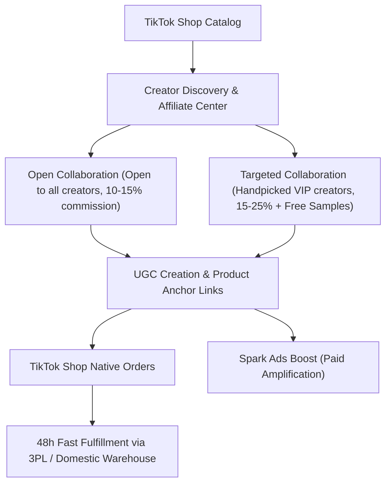

# Emerging Marketplaces Playbook: TikTok Shop, Temu & B&Q (Mirakl)

Expanding beyond Amazon creates platform resilience, unlocks new demographic segments, and captures explosive growth in social and discount commerce.

---

## 1. TikTok Shop: Social Commerce Engine

TikTok Shop fuses viral short-form content and LIVE broadcasts directly with a native in-app checkout.

### Strategic Levers:
1. **Affiliate Collaboration Models**:
   - **Open Collaboration**: Set standard 10%-15% commission. Any creator on TikTok can add your product to their Showcase.
   - **Targeted Collaboration**: Send targeted invites to 100+ niche creators weekly with 15%-20% commission + complimentary sample fulfillment upon approval.
2. **Shop Performance SLAs**:
   - **Dispatch Time**: Must hand over to carrier within 48 hours (business days).
   - **Late Dispatch Rate (LDR)**: Must be $< 4\%$.
   - **Seller Fault Cancellation Rate (SFCR)**: $< 2.5\%$.
   - **Customer Service Response Time**: Respond to in-app chats within 24 hours.
3. **LIVE Shopping Operations**:
   - Host weekly 2-3 hour brand LIVEs with exclusive time-limited flash vouchers ("Orange Bag" pinned discounts).

---

## 2. Temu: Semi-Managed (Local-to-Local) Operations

Unlike Temu's legacy fully-managed model (where goods had to be shipped in bulk to Chinese consolidation hubs), the **Temu Semi-Managed Model** empowers domestic warehouse owners to fulfill directly from domestic warehouses (UK/US/EU).

### Key Execution Rules:
1. **Fulfillment SLAs**:
   - Must fulfill and generate valid tracking within **24 to 48 hours** of order placement.
   - Domestic delivery must be completed within 2 to 5 business days.
2. **Pricing & Margin Architecture**:
   - Temu operates on a wholesale settlement model: you propose your target supply price (settlement price), and Temu sets the consumer retail price.
   - Factor in domestic pick/pack/ship costs + platform commission (typically 5-10% depending on category) to ensure a minimum net profit margin of 20-30%.
3. **Listing & Categorization**:
   - High-resolution white-background imagery (1000x1000px).
   - Video showcases showing product utility in the first 5 seconds.

---

## 3. B&Q Marketplace (Kingfisher / Mirakl Platform)

B&Q (part of Kingfisher Group) is the leading UK DIY and Home Improvement retailer. Its online marketplace operates via the **Mirakl Marketplace Platform**.

### Operational Playbook:
1. **Product Categorization & Attributes**:
   - Products must fit home, garden, DIY, kitchen, lighting, hardware, tools, or outdoor living categories.
   - Mandatory attributes: EAN/GTIN barcodes, manufacturer part numbers (MPN), material composition, dimensions, and UKCA / CE compliance certificates.
2. **Logistics & Delivery Promises**:
   - Standard Delivery (2-3 business days) and Express Delivery (Next Day).
   - For bulky or heavy items, support 2-man freight delivery with scheduled delivery slots.
3. **Mirakl Customer Service SLAs**:
   - Customer query response time: $< 24$ hours.
   - Return authorization window: 48 hours.
   - Keep customer evaluation score above **4.5 / 5.0**.
