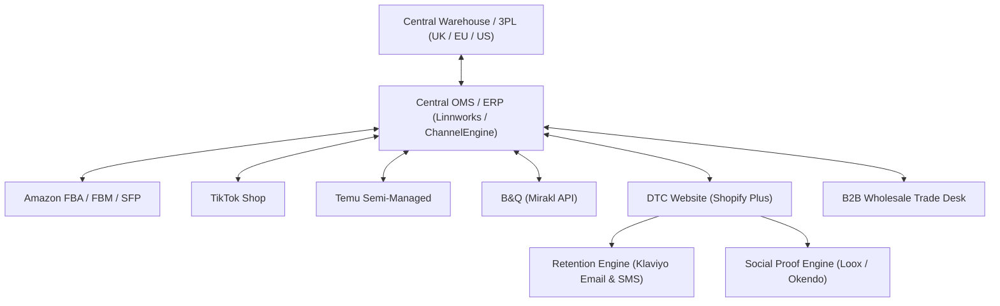

# DTC Website & Multi-Channel Tech Stack Synchronization

When selling across 6+ channels (Amazon 3P/1P, TikTok, Temu, B&Q, DTC, and Wholesale), **centralized inventory and order routing** is non-negotiable. Without it, stockouts, late shipments, and account suspensions are inevitable.

---

## 1. Multi-Channel Unified Architecture

---

## 2. Central Inventory Buffer & Allocation Rules

To protect Amazon SFP and TikTok Shop seller health metrics from unexpected spikes:
1. **Virtual Buffer Rules**:
   - Apply a dynamic buffer of **$-2$ to $-5$ units** on high-frequency channels (TikTok & Temu) to prevent overselling when stock drops below 10 units.
2. **Channel Priority Logic**:
   - Priority 1: Wholesale Confirmed POs & Amazon Vendor Central (Contractual penalties).
   - Priority 2: Amazon SFP (Prime badge SLAs).
   - Priority 3: TikTok Shop & Temu (Strict 48h dispatch SLAs).
   - Priority 4: DTC Website & Amazon Standard FBM.
3. **Automated Inventory Sync Interval**:
   - Ensure the OMS syncs inventory quantities to all marketplaces every **5 to 15 minutes**.

---

## 3. DTC Website (Shopify Plus / WooCommerce) Conversion Playbook

Your direct website captures the highest net profit margins (no 15% marketplace commissions) and provides direct ownership of customer data.

### High-Converting Store Architecture:
- **Above-The-Fold Product Page (PDP)**:
  - 10+ high-res lifestyle and video assets.
  - Star ratings & total verified buyer count.
  - Dynamic payment badges (Shop Pay, Apple Pay, Google Pay, Klarna, Clearpay).
  - Clear stock status ("In stock - dispatched within 24 hours").
  - Free shipping threshold banner (e.g., "Free UK delivery on orders over £40").
- **Klaviyo Automated Retention Flows**:
  1. *Welcome Series (3-part)*: Discount incentive + Brand Story + Best Sellers.
  2. *Abandoned Cart / Checkout*: Sent at 1 hour, 12 hours, and 24 hours with dynamic cart rebuild links.
  3. *Post-Purchase Onboarding*: How-to guide + care instructions + cross-sell offer on Day 14.
  4. *Win-Back Series*: Triggered at Day 60-90 for consumables or repeat-purchase items.
