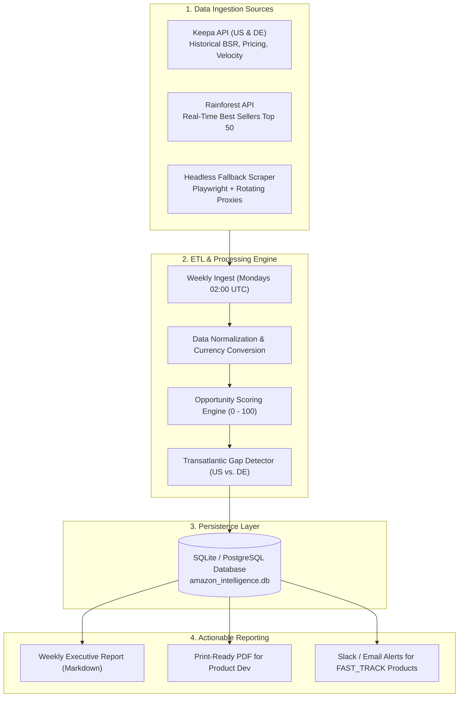

# Amazon US & Germany Weekly Top 50 Product Intelligence System

**System Name:** Transatlantic E-Commerce Product Discovery & Intelligence Engine  
**Lead Advisory Unit:** `marketplace_specialist` (Chief Marketplace Operations Lead)  
**Target Marketplaces:** Amazon US (`amazon.com`) & Amazon Germany (`amazon.de`)  
**Output Recipient:** Enterprise Product Development Team & Fairytales SMM Creative Studio  

---

## 1. System Architecture & High-Level Flow



---

## 2. Best-in-Class Extraction Architecture: Comparison of Approaches

| Approach | Reliability | Cost | Rate Limits / Anti-Bot | Recommendation |
| :--- | :--- | :--- | :--- | :--- |
| **Keepa API** | **99.9% (Gold Standard)** | ~€49 - €189 / month | 100 - 300 tokens/min; **Zero IP blocking**, covers both US (Domain 1) & DE (Domain 3). | **PRIMARY / RECOMMENDED** |
| **Rainforest API** | **99.5%** | ~$59 - $149 / month | Structured JSON specifically for Amazon Best Sellers Top 50. | **SECONDARY / FALLBACK** |
| **Custom Playwright Scraper** | 70.0% - 85.0% | Free + Proxy costs ($30/mo) | Frequent CAPTCHA challenges, DOM selector breaks; requires rotating residential proxies. | **LOCAL TESTING ONLY** |

### Why Keepa API is the Industry Standard:
1. **Historical BSR Validation**: Shows whether a product is genuinely a top seller over 90 days vs. an artificial 2-day spike.
2. **Review Velocity Tracking**: Tracks exact new review acquisition rate per week.
3. **Multi-Domain Native**: Single API call retrieves data across US, Germany, UK, France, and Italy simultaneously.

---

## 3. Product Development Opportunity Scoring Algorithm

The system ranks all Top 50 category products on a **0 to 100 Opportunity Score**:

$$\text{Opportunity Score} = (0.35 \times V) + (0.25 \times B) + (0.20 \times M) + (0.20 \times G)$$

Where:
- **Velocity Score ($V$, Weight: 35%)**: Based on BSR rank (1–50) and estimated monthly sales velocity. Top 10 BSR scores 100, BSR 11–25 scores 80, BSR 26–50 scores 60.
- **Review Barrier Score ($B$, Weight: 25%)**: Inverted review count. Products with $< 500$ reviews score 100 (easy to compete with using Vine reviews & Fairytales SMM UGC). Products with $> 5,000$ reviews score 20 (saturated incumbents).
- **Margin Potential ($M$, Weight: 20%)**: Price point sweet-spot ($25 - $75 or €25 - €75). Allows healthy gross margins after Amazon FBA fees and ad spend.
- **Transatlantic Gap ($G$, Weight: 20%)**: Highest bonus (+25 points) awarded to products ranking in the **US Top 50 that have zero or low-competition equivalents in Amazon Germany**.

---

## 4. The Transatlantic Arbitrage Engine (US $\to$ Germany)

One of the largest unfair advantages for European brands is **Trend Lag**:
- Trends often explode on TikTok US and Amazon US **3 to 9 months before reaching Germany**.
- The system flags products with high US velocity that have low German catalog saturation.

### German Market Product Development Compliance Checklist:
1. **VerpackG (LUCID)**: Mandatory German packaging recycling registration.
2. **WEEE & ElektroG**: Required for any electronics/gadgets sold into Germany.
3. **CE / Product Safety (GPSR)**: EU General Product Safety Regulation requiring designated EU Economic Operators on packaging.
4. **German Language Manual & Packaging**: High consumer standard for native German instructions.

---

## 5. Automated Weekly Cron Pipeline

The workflow runs automatically on a scheduled cron cadence:
```cron
# Run every Monday at 02:00 AM UTC
0 2 * * 1 /usr/bin/python3 /Users/mamun/Documents/Business\ Consultant/scripts/amazon_product_tracker.py --run-weekly
```
