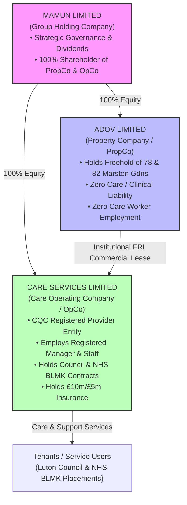
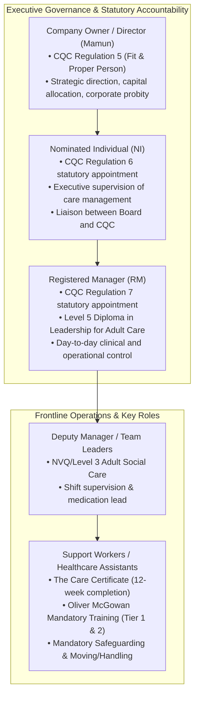
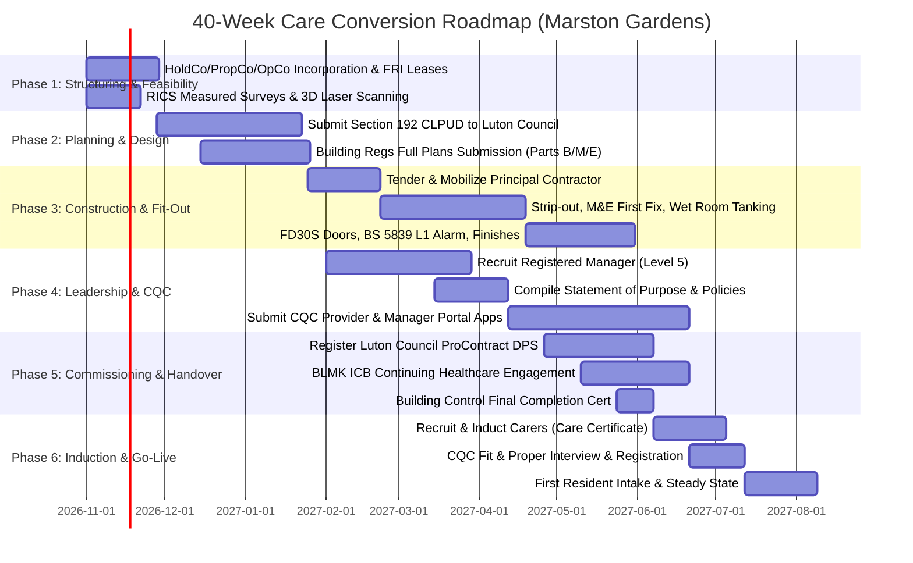

# CARE HOME & SUPPORTED LIVING MASTER BLUEPRINT & PROJECT PLAN
## Conversion of 78 & 82 Marston Gardens, Luton, LU2 7DY
### Commissioned under Luton Borough Council Adult Social Care & NHS BLMK ICB

---

## 1. EXECUTIVE SUMMARY & STRATEGIC MODEL SELECTION

This master blueprint establishes the complete legal, regulatory, architectural, clinical, and operational roadmap to convert:
* **78 Marston Gardens, Luton, LU2 7DY** (6-bedroom residential property)
* **82 Marston Gardens, Luton, LU2 7DY** (4-bedroom residential property)

into high-quality, council- and NHS-funded adult social care facilities.

### 1.1 The Strategic Choice: Care Home (Class C2) vs. Supported Living (Class C3b)

| Dimension | Option A: Registered Residential Care Home (Class C2) | Option B: Supported Living Scheme (Class C3b) [RECOMMENDED] |
| :--- | :--- | :--- |
| **CQC Regulated Activity** | *Accommodation for persons who require nursing or personal care* | *Personal Care* (Domiciliary Care / Supported Living) |
| **Premises Status** | Physical buildings (78 & 82) must be registered as CQC service locations. | Premises are domestic tenancies; CQC only registers the provider's office. |
| **Planning Permission** | **Class C2 (Residential Institution)**: Mandatory full planning application (Section 57). Subject to local planning objections and policies. | **Class C3(b)**: Up to 6 residents living together receiving care. Permitted development / Section 192 **Certificate of Lawfulness (CLPUD)**. |
| **Tenancy / Legal Status** | License to Occupy. Care and housing are bundled into one indivisible contract. | **Assured Shorthold Tenancy (AST)**. Housing and care are strictly separated by law. |
| **Funding & Revenue Model**| Single composite weekly fee from Luton Council / BLMK ICB (£850–£1,600/week/resident). | **Dual Revenue Stream**: 1) Housing Benefit Supported Exempt Accommodation (SEA) £250–£450/week/bed for rent/maintenance + 2) Commissioned Care Hours (£19.50–£28.50+/hr). |
| **CQC RSRCRC Clustering Risk**| High risk if registering 10 beds together on the same street for Learning Disabilities/Autism. | High risk if operated as a single mini-campus. **De-risked via cohort differentiation**. |

### 1.2 The Recommended "Dual-Cohort" Strategy
To completely eliminate CQC's anti-clustering objections under *"Right Support, Right Care, Right Culture"* (RSRCRC) and ensure seamless town planning approvals under Class C3(b):

1. **78 Marston Gardens (6-bed property)**:
   * **Capacity**: 5 Service Users + 1 Staff Sleep-in / Office.
   * **Target Cohort**: **Adult Mental Health Step-Down & Psychosocial Rehabilitation** (Section 117 Mental Health Act 1983).
   * **Commissioner Fit**: Severe local bed-blocking at **Calnwood Court** (East London NHS Foundation Trust - ELFT mental health inpatient unit at Luton & Dunstable Hospital).
   * **Planning**: Class C3(b) Lawful Development Certificate (CLPUD) for 6 occupants total.

2. **82 Marston Gardens (4-bed property)**:
   * **Capacity**: 3 Service Users + 1 Staff Sleep-in / Office.
   * **Target Cohort**: **Adult Learning Disabilities, Autism & Complex Behaviours** (Positive Behaviour Support - PBS).
   * **Commissioner Fit**: Luton Borough Council Adult Social Care high-cost out-of-borough repatriation target.
   * **Planning**: Class C3(b) Lawful Development Certificate (CLPUD) for 4 occupants total (< 6 cap).

---

## 2. CORPORATE STRUCTURING, ASSET PROTECTION & TAX ARCHITECTURE

To insulate your multimillion-pound property assets from operational social care liabilities, the enterprise must be organized into a **HoldCo – PropCo – OpCo** structure:



### 2.1 Entity Functions & Liability Insulation
1. **`Mamun LIMITED` (Holding Company / HoldCo)**:
   * Top-tier parent entity. Holds 100% share capital of `ADOV LIMITED` and `[New Entity] Care Services LIMITED`.
   * Accumulates group profits and distributes dividends. Insulated from all operating liabilities.
2. **`ADOV LIMITED` (Property Company / PropCo)**:
   * Retains the freehold/long-leasehold titles to 78 and 82 Marston Gardens.
   * Acts purely as a commercial property investment and asset-holding vehicle.
   * **Never enters care contracts, never employs care workers, and never provides care**. If OpCo faces a CQC regulatory fine, medical malpractice lawsuit, or corporate manslaughter claim, PropCo's physical assets cannot be attached by creditors.
3. **`[New Entity] Care Services LIMITED` (Care Operating Company / OpCo)**:
   * Newly incorporated limited company.
   * Applies to CQC as the **Registered Provider**.
   * Employs the Registered Manager, Care Coordinators, and Support Workers.
   * Holds the public liability (£10m), employers' liability (£10m), and medical malpractice/professional indemnity insurance (£5m).
   * Contracts directly with Luton Borough Council and NHS BLMK ICB.

### 2.2 Commercial Lease & Intercompany Agreements
* **Full Repairing and Insuring (FRI) Lease**: ADOV LIMITED grants a 5- to 15-year commercial lease to OpCo (or in Supported Living, to an approved Registered Social Landlord / Housing Association partner who sub-leases to tenants).
* **Arm's Length Commercial Terms**: Rent must reflect independent RICS market valuations to satisfy HMRC transfer pricing rules. Rent is a tax-deductible operational expense for OpCo and taxable commercial property rental income for ADOV LIMITED.

### 2.3 VAT & Tax Considerations
* **Social Care Exemption**: Welfare services and personal care provided by a CQC-registered entity or state-regulated body are **exempt from VAT** under Schedule 9, Group 7 of the Value Added Tax Act 1994 (VATA 1994).
* **Input VAT Recovery**: Because OpCo makes VAT-exempt supplies, it cannot recover VAT paid on its operational purchases.
* **Option to Tax Warning**: ADOV LIMITED should generally **NOT** opt to tax the residential properties for VAT purposes. If PropCo opts to tax the lease, it must charge 20% VAT on the rent to OpCo, which OpCo cannot recover, creating an irrecoverable 20% cash leakage.
* **Capital Works VAT (Notice 708)**: Where properties are converted for a "Relevant Residential Purpose" (RRP - residential accommodation for people in need of care), certain qualifying construction and refurbishment works may qualify for a **reduced rate of VAT (5%)** or zero-rating, provided an RRP Certificate is issued before works commence.

---

## 3. PERSONNEL QUALIFICATIONS & EXECUTIVE RESPONSIBILITIES



### 3.1 What Qualifications Do YOU Need as the Owner / Director?
* **You do NOT need a medical, nursing, or social care degree to own the company or sit as an Executive Director**.
* You must satisfy **CQC Regulation 5: Fit and Proper Persons Requirement (FPPR)**:
  1. Enhanced DBS Check (countersigned via CQC, clean of disqualifying convictions);
  2. Proof of financial probity (no undischarged bankruptcies, County Court Judgments, or insolvency history);
  3. No disqualification under the Company Directors Disqualification Act 1986;
  4. Satisfactory employment history with verified references.

### 3.2 Nominated Individual (NI) Requirements (CQC Regulation 6)
* **Corporate Standing**: Must be an employed Director, Manager, or Company Secretary of the registered provider entity. An outside consultant cannot be the NI.
* **Statutory Role**: Legally mandated to *"supervise the management of the carrying on of the regulated activity"*.
* **Competency Benchmark**: Demonstrable executive knowledge of health and social care regulations, CQC Single Assessment Framework, safeguarding protocols, and corporate clinical governance.
* **Strategic Option**: If you do not possess prior social care management experience, appoint an experienced healthcare director (e.g. former Registered Manager, Nurse, or Social Work Director) to your OpCo Board of Directors to serve as the Nominated Individual.

### 3.3 Registered Manager (RM) Requirements (CQC Regulation 7)
* **Mandatory Statutory Qualification**:
  * **Level 5 Diploma in Leadership and Management for Adult Care (England)** (RQF), or recognized legacy equivalents (NVQ Level 4 in Health and Social Care, Registered Manager Award - RMA).
  * If a nursing care home: Must hold an active Registered Nurse (RN/RNLD/RMN) PIN with the Nursing and Midwifery Council (NMC).
* **Operational Track Record**: Minimum **2 to 3 years** in a senior supervisory capacity (Deputy Manager or Team Leader) within the specific client cohort (Mental Health Step-Down or Autism / Learning Disabilities).
* **CQC "Fit and Proper" Registration Interview**:
  * Comprehensive 90- to 150-minute examination on Regulations 9–20A (Person-Centred Care, Safeguarding, Consent & Mental Capacity Act, Safe Staffing, Duty of Candour).
  * Crisis management scenario testing (e.g., immediate handling of medication errors, whistleblowing allegations, adult safeguarding referrals).

### 3.4 Frontline Staff Qualifications & Mandatory Training
* **The Care Certificate**: All new care workers must complete the 15 standards within the first 12 weeks of employment.
* **Oliver McGowan Mandatory Training on Learning Disability and Autism**: Legal requirement under the Health and Care Act 2022 and CQC Regulation 18:
  * Tier 1: Ancillary and administrative staff.
  * Tier 2: All direct care staff and managers (co-delivered with an expert by experience).
* **Statutory Training Suite**:
  * Adult Safeguarding (Level 2 for staff, Level 3 for Managers);
  * Safe Handling and Administration of Medicines (NICE SC1 guidelines + annual observational audits);
  * Mental Capacity Act 2005 & Deprivation of Liberty Safeguards (DoLS);
  * Positive Behaviour Support (PBS) & BILD-accredited physical intervention reduction (e.g. MAPA/CPI/PROACT-SCIPr-UK);
  * Moving and Handling (Principles & Practical Hoisting);
  * Basic Life Support / First Aid at Work (3-day HSE certified);
  * Infection Prevention and Control (HTM 01-04 and CQC Code of Practice);
  * Food Safety & Hygiene (Level 2 minimum).

---

## 4. AUTHORITY REQUIREMENTS: CQC, LUTON COUNCIL & NHS BLMK

### 4.1 CQC Registration Framework (Single Assessment Framework)
Registration applications are submitted through the CQC Provider Portal, evaluated across **5 Key Questions** and **34 Quality Statements**:

1. **Safe**: Safeguarding adults at risk; safe staffing rotas; environmental health and safety; medication optimization; infection prevention.
2. **Effective**: Assessing needs; evidence-based care; nutrition and hydration; consent under the Mental Capacity Act 2005.
3. **Caring**: Treating people with dignity, respect, and compassion; promoting independence.
4. **Responsive**: Person-centred care plans; supporting transition pathways; addressing complaints.
5. **Well-Led**: Governance frameworks; culture of openness (Duty of Candour); continuous quality audits; registered manager oversight.

### 4.2 Luton Borough Council Adult Social Care Commissioning
* **Procurement Portal**: Register your OpCo on the **ProContract (by Proactis)** e-tendering portal (East of England Regional Hub).
* **Dynamic Purchasing System (DPS) / Approved Provider List (APL)**:
  * Apply under CPV codes: `85000000-9` (Health and social work), `85311000-2` (Social work services with accommodation), `85311200-4` (Services for disabled persons).
  * Selection Questionnaire (SQ) thresholds: CQC registration (or application in progress), £10m Employer’s Liability, £5m Public Liability, audited financial models, LSAB-aligned Safeguarding policy, and local social value commitments aligned with the *Luton 2040 Vision*.

### 4.3 NHS Bedfordshire, Luton & Milton Keynes (BLMK) ICB Commissioning
* **Continuing Healthcare (CHC)**: Fully NHS-funded placements for adults with primary health needs, commissioned via the BLMK CHC Commissioning Team (Arndale House, The Mall, Luton).
* **Section 117 Mental Health Act Aftercare**: Joint statutory funding between Luton Council and BLMK ICB for individuals discharged from inpatient psychiatric units (such as Calnwood Court at Luton & Dunstable Hospital). Care and accommodation are **free of charge** to the service user.

### 4.4 Commercial & Financial Architecture (Supported Living Dual-Stream Model)

```
┌─────────────────────────────────────────────────────────────────────────────┐
│                 DUAL-STREAM REVENUE MODEL (PER PROPERTY / BED)              │
├───────────────────────────────────────┬─────────────────────────────────────┤
│ STREAM 1: HOUSING & PROPERTY COSTS    │ STREAM 2: CARE & SUPPORT HOURS      │
│ (Covered by Housing Benefit - SEA)    │ (Commissioned by Council / NHS ICB) │
├───────────────────────────────────────┼─────────────────────────────────────┤
│ • Core Rent (Lease to PropCo)         │ • Core Shared Care (24/7 rota)      │
│ • Intensive Housing Management (IHM)  │ • Enhanced 1:1 Care Hours           │
│ • Communal Repairs & Maintenance      │ • Specialist PBS 2:1 Support        │
│ • Fire Alarm & Compliance Servicing   │ • Waking Night / Sleep-in Cover     │
├───────────────────────────────────────┼─────────────────────────────────────┤
│ Yield: £250.00 – £450.00 / week / bed │ Yield: £1,200 – £4,500+ / week / bed│
└───────────────────────────────────────┴─────────────────────────────────────┘
```

* **Annual Revenue Potential Across Both Properties (8 Service Users Total)**:
  * Housing Benefit Stream: 8 beds × £350/wk avg = **£145,600 / year** (covers PropCo commercial lease, building insurance, maintenance).
  * Care Hours Stream: 8 beds × £2,200/wk avg = **£915,200 / year** (covers care staff salaries, management, training, operational profit).
  * **Combined Gross Annual Revenue**: **£1,060,800 / year**.

---

## 5. PHYSICAL PROPERTY, ARCHITECTURAL & FIRE SAFETY REQUIREMENTS

### 5.1 Property Capacity & Layout Allocation

| Property | Capacity Allocation | Ground Floor Configuration | First Floor / Upper Configuration |
| :--- | :--- | :--- | :--- |
| **78 Marston Gardens** (6-Bed Baseline) | **5 Service Users + 1 Staff Sleep-in / Office** | • 1 Accessible Resident Bedroom (Doc M En-suite)<br/>• Communal Lounge (≥16m²)<br/>• Communal Dining (≥12m²)<br/>• Commercial Kitchen (Rating 5)<br/>• Doc M Visitor WC<br/>• HTM 01-04 Laundry & Sluice Room | • 4 Resident Bedrooms (All En-suite Wet Rooms)<br/>• Staff Sleep-in / Management Office with En-suite<br/>• Secure Medication & IT Store |
| **82 Marston Gardens** (4-Bed Baseline) | **3 Service Users + 1 Staff Sleep-in / Office** | • Communal Living Room (≥14m²)<br/>• Communal Dining Area (≥10m²)<br/>• Catering Kitchen (≥10.5m²)<br/>• Doc M Visitor WC<br/>• Utility / HTM 01-04 Laundry | • 3 Resident Bedrooms (All En-suite Wet Rooms)<br/>• Staff Sleep-in / Office with Private WC<br/>• Secure Controlled Drugs Safe Alcove |

### 5.2 Room Dimensions & Spatial Benchmarks
* **Bedrooms**: Minimum **10.0 m² – 12.0 m²** net usable floor area (excluding en-suite bathroom and lobby). Ground floor wheelchair accessible rooms must achieve **13.5 m² – 15.0 m²** with a 1500mm wheelchair turning circle (Approved Document M4(3)).
* **En-suite Wet Rooms**: Minimum clear dimensions **2200mm × 2000mm** (4.40 m²). Heavy-duty slip-resistant safety vinyl (Altro Aquarius or Polyflor Hydro, Pendulum Test Value **PTV ≥ 36 wet**, R11 rating). Welded seams with continuous 100mm coved skirting.
* **Anti-Scald TMV3 Valves**: Mandatory compliance with BS EN 1111/1287 and HSE HSIS6. Showers and washbasins preset with fail-safe shut-off at **strictly 41°C** (assisted baths max 44°C).
* **Communal Living & Dining**: Minimum **4.1 m² to 5.1 m² per resident** (78 Marston Gardens requires min. 20.5–25.5 m²; 82 Marston Gardens requires min. 12.3–15.3 m²).
* **Commercial Kitchen (5-Star Food Hygiene)**: Unidirectional food workflow, separate handwash basin with wrist/sensor taps, Grade 304 catering stainless steel, Altro Whiterock hygienic wall cladding, commercial pass-through dishwasher with thermal rinse reaching **82°C for 15 seconds**, automated 24/7 fridge/freezer temperature monitors.
* **Commercial Laundry (HTM 01-04)**: Industrial washing machine with sluice cycle and thermal disinfection (**71°C for 3 minutes** or 65°C for 10 minutes), direct exterior-vented industrial dryer, red alginate dissolvable bags for soiled linen.
* **Secure Medication Storage**: Controlled Drugs cabinet compliant with **Misuse of Drugs (Safe Custody) Regulations 1973** and BS 2881, bolted to solid brickwork with 4 × M10 rawlbolts. Specialized medical refrigerator (+2°C to +8°C). Room temperature maintained below 25°C.

### 5.3 Fire Safety Engineering (Building Regs Part B & Fire Safety Order 2005)
* **Fire Alarm System**: Installed to **BS 5839-1:2017 Category L1** (comprehensive addressable protection across all bedrooms, circulation corridors, roof voids, and cupboards).
  * Minimum sound level: **75 dBA at bedheads** in all bedrooms with doors shut.
  * Visual Alarm Devices (VADs) compliant with BS EN 54-23 in all rooms.
  * Direct 30-second off-site transmission to Alarm Receiving Centre (ARC).
* **Fire Doors**: Certified **FD30S** assemblies (44mm solid core, 15mm intumescent strips, cold smoke seals). Overhead hydraulic closers (BS EN 1154). Fitted with **BS EN 1155 electromagnetic free-swing hold-open devices** acoustically linked to the fire alarm (allowing residents domestic operation while automatically fail-safe closing upon alarm activation).
* **Compartmentation**: 30/60-minute fire-resisting protected escape stairwells and corridors lined with twin 12.5mm Gyproc FireLine plasterboard. Intumescent pipe collars on all drainage penetrations.
* **Emergency Lighting**: Installed to **BS 5266-1:2016** with 3-hour battery autonomy, providing minimum 1.0 lux along escape paths and 5.0 lux at fire alarm panels and first aid stations.
* **Acoustic Insulation (Part E)**: Bedroom partition walls and intermediate floors engineered to achieve airborne sound insulation **≥ 43–48 dB** and impact sound **≤ 62 dB** (acoustic studs, 100mm Rockwool RW3, twin 15mm SoundBloc plasterboard, Cellecta ScreedBoard 28 floor overlay).
* **Window Restrictors**: HSE HSIS3 compliant tamper-proof safety restrictors limiting all upper-floor window openings to **maximum 100mm**.

### 5.4 Planning Permission Strategy (Town & Country Planning)
* **The Section 192 CLPUD Pathway**:
  * Apply to Luton Borough Council for a **Certificate of Lawfulness for Proposed Use or Development (CLPUD)** under Section 192 of the Town and Country Planning Act 1990 for **Class C3(b) Supported Living** (up to 6 residents living together as a single household receiving care).
  * Determined strictly on points of law and fact, NOT discretionary planning policy. Luton Council cannot refuse a CLPUD based on parking, neighbor objections, or housing supply policies.
  * HMO Article 4 Directions in Luton do **NOT** restrict Class C3(b).
* **Driveway & Parking Allocation (Policy LLP32)**:
  * 78 Marston Gardens: 3–4 dedicated off-street permeable block paved parking bays + 7.4 kW Type 2 EV Charger + 2-bay secure cycle store.
  * 82 Marston Gardens: 2–3 dedicated off-street parking bays + 7.4 kW EV Charger + 2-bay secure cycle store.
  * Staggered shift rotas (07:30–15:30, 15:00–22:00, 21:45–07:45) ensure staff changeovers occur outside peak school/traffic hours.

---

## 6. COMPLETE A-TO-Z STEP-BY-STEP PROJECT EXECUTION PLAN



### Phase 1: Corporate Structuring, Governance & Surveys (Weeks 1–4)
* **Step 1.1**: Incorporate `[New Entity] Care Services LIMITED` at Companies House (SIC 87200 / 87900 / 88100) under `Mamun LIMITED`.
* **Step 1.2**: Draft institutional Full Repairing and Insuring (FRI) commercial lease agreements between `ADOV LIMITED` and the new OpCo.
* **Step 1.3**: Appoint the Board of Directors and formally designate the Nominated Individual (Regulation 6).
* **Step 1.4**: Compile the Regulation 5 Fit and Proper Person dossier (Enhanced DBS, references, solvency checks).
* **Step 1.5**: Commission RICS measured building surveys, underground drainage CCTV surveys, and asbestos R&D surveys for both properties.

### Phase 2: Planning Consents & Architectural Engineering (Weeks 5–14)
* **Step 2.1**: Submit Section 192 CLPUD applications to Luton Borough Council Planning Department for Class C3(b) use.
* **Step 2.2**: Prepare full architectural working drawings and structural calculations (lintels, door widening to 850mm clear).
* **Step 2.3**: Engineer M&E specifications: BS 5839-1 Category L1 fire alarm layout, BS 5266-1 emergency lighting, TMV3 plumbing schematics, and Approved Document E acoustic party wall/floor details.
* **Step 2.4**: Submit Full Plans Building Regulations application to Luton Building Control.

### Phase 3: Procurement & Capital Refurbishment Works (Weeks 15–28)
* **Step 3.1**: Issue tender packages to CHAS / SafeContractor accredited Principal Contractors; award JCT Minor Works Building Contract.
* **Step 3.2**: Execute strip-out and structural repartitioning.
* **Step 3.3**: First fix plumbing and electrical (CAT6 cabling, nurse call trunking, L1 fire alarm wiring in FP200 Gold cable).
* **Step 3.4**: Install Approved Document E acoustic insulation (resilient bars, 100mm RW3, twin SoundBloc, Cellecta ScreedBoard 28).
* **Step 3.5**: Install Part M accessible en-suite wet rooms (tanking membranes, Altro Aquarius PTV≥36 vinyl, Doc M sanitaryware, TMV3 valves).
* **Step 3.6**: Hang certified FD30S fire doors with BS EN 1155 hold-open retainers and intumescent/cold smoke seals.
* **Step 3.7**: Fit out commercial kitchen (Altro Whiterock, pass-through thermal dishwasher 82°C) and HTM 01-04 laundry room.
* **Step 3.8**: External driveway block paving (3–4 bays at #78, 2–3 bays at #82), 7.4 kW EV charger, and secure cycle storage.

### Phase 4: Workforce Recruitment & CQC Registration Application (Weeks 20–32)
* **Step 4.1**: Recruit qualified Registered Manager (holding Level 5 Diploma in Leadership for Adult Care and 2–3+ years supervisory experience).
* **Step 4.2**: Draft complete CQC documentation suite: Statement of Purpose (detailing 78 and 82 Marston Gardens separately), Business Plan, Financial Viability Statement, and Safeguarding Protocols.
* **Step 4.3**: Author bespoke clinical and operational policies compliant with the CQC Single Assessment Framework (Regulations 9–20A).
* **Step 4.4**: Submit corporate provider and registered manager applications via the CQC Provider Portal.

### Phase 5: Commissioning Accreditation & Statutory Completion (Weeks 30–36)
* **Step 5.1**: Register OpCo on the Luton Borough Council ProContract portal; complete the Supported Living DPS / APL Selection Questionnaire.
* **Step 5.2**: Establish direct liaison with the BLMK ICB Continuing Healthcare Commissioning Team (Arndale House, Luton) and East London NHS Foundation Trust (ELFT) mental health discharge coordinators.
* **Step 5.3**: Secure statutory completion certificates:
  * Building Control Final Completion Certificate;
  * NICEIC Electrical Installation Certificate (EIC);
  * Gas Safe Landlord Gas Safety Record (CP12);
  * BS 5839-1 Fire Alarm Commissioning Certificate;
  * BS 5266-1 Emergency Lighting Certificate;
  * TMV3 Anti-Scald Commissioning Certificate;
  * Commission an independent BAFE SP205 / IFE Tier 3 Type 3 Fire Risk Assessment (FRA).

### Phase 6: Operational Readiness, Staff Induction & Launch (Weeks 36–40+)
* **Step 6.1**: Undertake the CQC Registered Manager and Nominated Individual "Fit and Proper" registration interviews via Microsoft Teams.
* **Step 6.2**: Receive CQC Certificate of Registration.
* **Step 6.3**: Recruit frontline Support Workers; deliver 2-week intensive induction (Care Certificate, Oliver McGowan Tier 2 training, MAPA/PBS, eMAR training).
* **Step 6.4**: Deploy digital care planning and eMAR software (Nourish Care, CareControl, or Birdie) and nurse call master panels.
* **Step 6.5**: Review initial individual placement referrals from Luton Adult Social Care and BLMK ICB; conduct multi-agency transition assessments.
* **Step 6.6**: Admit first service users into 78 and 82 Marston Gardens under structured individual transition plans.

---

## 7. CAPITAL EXPENDITURE (BoQ) & FINANCIAL FEASIBILITY

### 7.1 Capital Works Budget Breakdown (Turnkey Conversion)

| Trade / Work Section | 78 Marston Gardens (6-Bed Baseline) | 82 Marston Gardens (4-Bed Baseline) | Total Estimated Cost |
| :--- | :--- | :--- | :--- |
| **1. Preliminaries, Planning & Professional Fees** | £22,000 | £18,000 | £40,000 |
| **2. Structural Alterations & Repartitioning** | £14,000 | £10,000 | £24,000 |
| **3. Part M Accessible Wet Rooms & Plumbing (TMV3)** | £42,000 (5 en-suites + 1 WC) | £26,000 (3 en-suites + 1 WC) | £68,000 |
| **4. Fire Safety, FD30S Doors & Compartmentation** | £26,000 | £19,000 | £45,000 |
| **5. Electrical, BS 5839-1 L1 Alarm & Emergency Lights**| £28,000 | £20,000 | £48,000 |
| **6. Approved Document E Acoustic Soundproofing** | £17,000 | £12,000 | £29,000 |
| **7. Commercial Kitchen (Food Hygiene Rating 5)** | £22,000 | £16,000 | £38,000 |
| **8. HTM 01-04 Laundry & Sluice Facility** | £19,000 | £14,000 | £33,000 |
| **9. Medication Safe, Security & Nurse Call Systems** | £8,000 | £6,500 | £14,500 |
| **10. Driveway Permeable Paving, EV Charger & Grounds**| £15,000 (3–4 bays) | £11,000 (2–3 bays) | £26,000 |
| **Subtotal Capital Refurbishment** | **£213,000** | **£152,500** | **£365,500** |
| **Contingency (12.5%)** | **£26,500** | **£19,000** | **£45,500** |
| **TOTAL TURNKEY CAPITAL EXPENDITURE** | **£239,500** | **£171,500** | **£411,000** |

### 7.2 Five-Year Financial Projections & Returns (Steady State - 8 Service Users)

```
┌─────────────────────────────────────────────────────────────────────────────┐
│               STEADY-STATE ANNUAL FINANCIAL PROFILE (COMBINED)              │
├───────────────────────────────────────────────────────┬─────────────────────┤
│ Gross Annual Revenue (Care Commissioning + SEA HB)    │ £1,060,800          │
│ Frontline Staffing & On-Costs (Rotas & Relief)        │ (£520,000)          │
│ Registered Manager & Leadership Salaries              │ (£95,000)           │
│ Property Lease Payments (Paid to ADOV LIMITED)        │ (£110,000)          │
│ Catering, Consumables & Activities                    │ (£42,000)           │
│ Insurance, CQC Fees, Software & Compliance            │ (£32,000)           │
│ Repairs, Utilities & Maintenance Provisions           │ (£38,000)           │
├───────────────────────────────────────────────────────┼─────────────────────┤
│ NET OPERATING PROFIT (EBITDA in OpCo)                 │ £223,800            │
│ RENTAL INCOME IN ADOV LIMITED (PropCo Net Rent)       │ £110,000            │
├───────────────────────────────────────────────────────┼─────────────────────┤
│ TOTAL ENTERPRISE ANNUAL CASH FLOW GENERATED           │ £333,800 / year     │
│ Return on Capital Employed (ROCE on £411k CapEx)      │ 81.2%               │
└───────────────────────────────────────────────────────┴─────────────────────┘
```

---

## 8. RISK MITIGATION & REGULATORY SAFEGUARDS

1. **CQC Clustering Trap**: 78 and 82 Marston Gardens are separated only by number 80. By designating 78 Marston Gardens for Mental Health Step-Down and 82 Marston Gardens for Autism/Learning Disabilities, you eliminate CQC's "mini-institution" clustering objection under RSRCRC.
2. **Planning Refusal Mitigation**: Avoid submitting a contentious C2 change of use application by securing a Section 192 CLPUD under Class C3(b). This provides an absolute legal defense against planning refusal and NIMBY neighbor objections.
3. **Void Risk & Referrals**: Pre-engage Luton Adult Social Care and BLMK ICB at Month 3 of the project so that transition assessments for service users are completed before physical handover, ensuring 100% occupancy within 60 days of launch.
