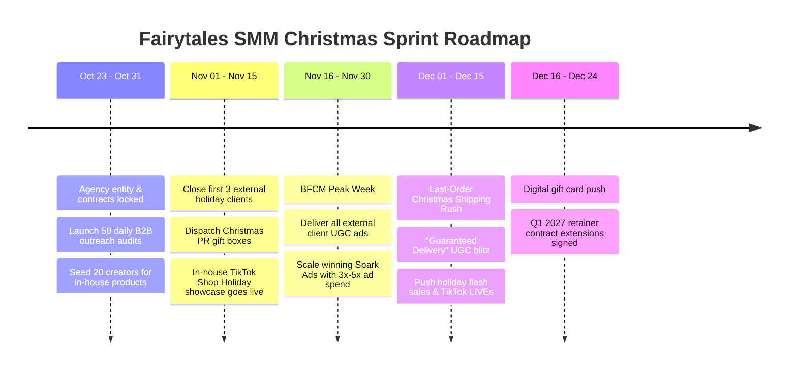

# Fairytales SMM: Standalone Agency Immediate Christmas & Q4 Blitzkrieg Business Plan

**Entity:** Fairytales SMM (Standalone Limited Agency)  
**Season:** Q4 Holiday Rush / BFCM & Christmas Season  
**Strategic Window:** Immediate Execution (October 23 – December 24)  
**Lead Agent:** `strategic_management_director` & `fairytales_smm_director`

---

## 1. Executive Summary: The Immediate Christmas Opportunity

With Christmas approaching in less than 8 weeks and Black Friday / Cyber Monday (BFCM) in roughly 4 weeks, e-commerce brands face **peak consumer spending accompanied by peak advertising costs**.

### Why Fairytales SMM Will Win Immediately:
1. **Urgency & Creative Exhaustion**: Brands have allocated holiday budgets, but their ad creatives are fatigued. They desperately need holiday-themed UGC ("Best Gift For...", "Stocking Stuffer Hacks", "Unboxing Reactions") and have no time for long agency onboarding.
2. **The Standalone Positioning**: Fairytales SMM acts as an agile creator studio and social commerce accelerator that guarantees **rapid 5-to-7 day creative turnaround** and **active creator gifting** before holiday shipping deadlines close.
3. **Dual Execution Engine**:
   - **Internal Brand Engine**: Packages our own products into festive gift bundles across Amazon, TikTok Shop, Temu, and DTC.
   - **External Client Engine**: Sells high-margin holiday UGC sprints and creator seeding packages to external consumer brands starting this week.

---

## 2. High-Converting Christmas Service Packages (Fast-Closing Offers)

Traditional 6-month retainers take too long to close in late Q4. We deploy **immediate cash-flow offers** with friction-free approvals:

```
+-----------------------------------------------------------------------------------------------------+
|                                   FAIRYTALES SMM HOLIDAY PACKAGES                                   |
+------------------------------+------------------------------+---------------------------------------+
| Package                      | Price & Terms                | Scope & Deliverables                  |
+------------------------------+------------------------------+---------------------------------------+
| 1. "7-Day Holiday UGC        | £1,950                       | • 6 High-converting holiday UGC ads   |
|     Sprint"                  | (100% Upfront)               | • 3 Hook iterations/ad (18 variations)|
|                              |                              | • 90-Day Spark/Whitelisting license   |
|                              |                              | • Delivery in 7 business days         |
+------------------------------+------------------------------+---------------------------------------+
| 2. "Christmas Influencer     | £3,950                       | • Outreach to 75 holiday creators     |
|     Seeding & TikTok Rush"   | (50% deposit, 50% on drop)   | • 20-30 Confirmed product seedings    |
|                              |                              | • Gift guide & wishlist placements    |
|                              |                              | • TikTok Shop affiliate setup         |
+------------------------------+------------------------------+---------------------------------------+
| 3. "Full Q4 Omnipresence &   | £6,950 / month               | • Everything in Packages 1 & 2        |
|     Ad Blitz" (Nov - Dec)    | (2-month commitment)         | • Paid ad management (TikTok & Meta)  |
|                              |                              | • Daily campaign scaling for BFCM     |
+------------------------------+------------------------------+---------------------------------------+
```

---

## 3. The 48-Hour Outbound Client Acquisition Engine

To sign external clients immediately, we do not wait for inbound SEO. We launch **direct outbound outreach** targeting consumer brands advertising on Meta & TikTok Shop.

### Target Profile:
- DTC and Amazon brands generating £20k–£200k/month in:
  - Beauty, Skincare & Grooming
  - Home, Kitchen & Cozy Lifestyle
  - Gadgets, Electronics & Novelty Gifts
  - Jewelry, Fashion & Accessories
  - Toys & Family Gifts

### 3-Step Outbound Cadence:
1. **The Creative Audit**: Identify brands whose Meta Ad Library / TikTok Creative Center shows generic static ads or zero holiday gifting hooks.
2. **The 60-Second Loom Teaser**: Send a personalized video showing 3 specific holiday hooks that will immediately lower their customer acquisition cost.
3. **The 15-Minute "Christmas Rescue" Strategy Call**: Close on Package 1 or Package 2 with work starting within 48 hours of contract sign-off.

---

## 4. Immediate Christmas Countdown Roadmap (October 23 – December 24)



---

## 5. Operations & Fulfillment Blueprint

### In-House Brand Tasks (Immediate):
- **Holiday Bundling**: Group 2-3 complimentary SKUs into a "Festive Holiday Bundle" with gift packaging to boost Average Order Value (AOV) by 30-50%.
- **TikTok Shop Affiliates**: Enable 20% commission on the TikTok Shop Affiliate Center with tag: `#ChristmasGiftIdeas`, `#HolidayGifts`, `#TikTokMadeMeBuyIt`.
- **Delivery Guarantees**: Prominently display "Guaranteed Delivery Before Christmas if ordered by Dec 18th" across all PDPs and UGC hooks.

### External Agency Client Operations:
- **Fast Creator Network**: Maintain an active roster of 40 pre-vetted UK & US micro-creators capable of 48-hour turnarounds once samples arrive.
- **Turnaround SLA**: Raw footage edited and captioned within 24 hours of creator upload.
