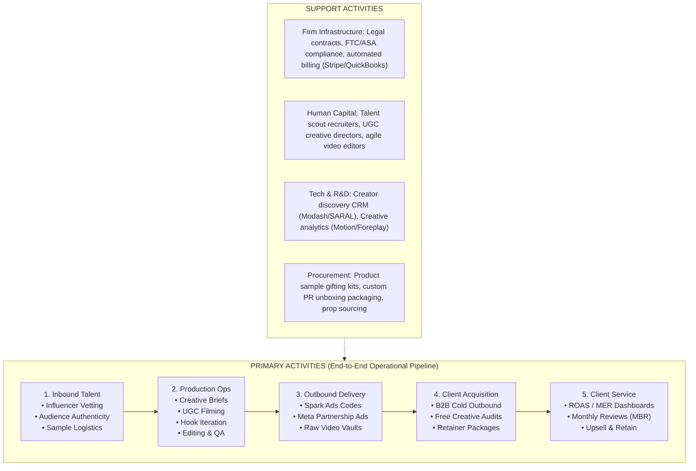
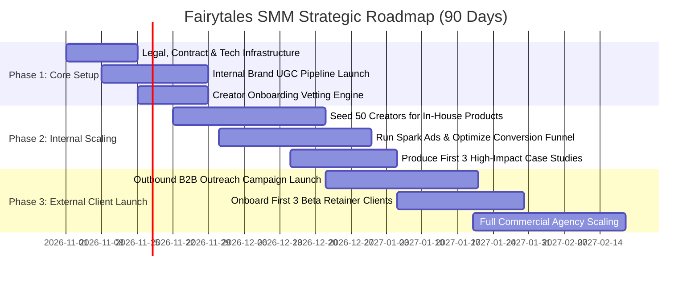

# Fairytales SMM: Strategic Management & Business Value Chain Architecture

**Document Type:** Enterprise Strategic Blueprint  
**Lead Agent:** `strategic_management_director`  
**Core Entity:** Fairytales SMM (Influencer Marketing, UGC Studio & Social Commerce Agency)

---

## 1. Strategic Positioning: The "Practitioner Advantage"

Most influencer and social media marketing agencies operate as theoretical middlemen with zero skin in the game. **Fairytales SMM** is built on a defensible, differentiated model:

```
+-------------------------------------------------------------------------------------------------+
|                                 THE FAIRYTALES SMM DUAL ENGINE                                  |
+------------------------------------------------+------------------------------------------------+
| IN-HOUSE E-COMMERCE BRANDS                     | EXTERNAL CLIENT BUSINESSES                     |
| (The Testing Lab)                              | (The Revenue Multiplier)                       |
+------------------------------------------------+------------------------------------------------+
| - Test viral hooks and creator angles with     | - Package proven winning frameworks into high- |
|   internal capital.                            |   margin monthly retainers ($3.5k-$10k/mo).    |
| - Rapid iteration across TikTok Shop & Meta.   | - Deploy vetted creator relationships and pre- |
| - Unfiltered first-party attribution data.     |   tested ad formats with zero guesswork.       |
+------------------------------------------------+------------------------------------------------+
```

### VRIO Competitive Moat Analysis
- **Value (V)**: Bridges creator discovery directly to revenue-producing assets (Spark Ads, TikTok Shop showcases, and Meta Partnership Ads).
- **Rarity (R)**: Dual infrastructure owning both physical distribution (Amazon, B&Q, Temu, DTC) and native creator production.
- **Inimitability (I)**: Proprietary creator network, whitelisting contracts, and proprietary 3-second hook conversion libraries.
- **Organization (O)**: Automated value chain workflows powered by specialized agent workflows and centralized CRM.

---

## 2. Porter's Business Value Chain for Fairytales SMM



---

### Primary Activity 1: Inbound Talent & Influencer Logistics
- **Vetting Criteria**:
  - Engagement Rate $\ge 3.5\%$ on TikTok / Instagram.
  - Audience Authenticity Score $> 85\%$ (detecting fake bots/pods via Modash/HypeAuditor).
  - Demographic congruence: $> 65\%$ target geographical match (UK/US/EU depending on campaign).
- **Automated Gifting & Sample Workflow**:
  - Integrate Shopify/Warehouse OMS with Creator CRM (e.g. SARAL / GRIN).
  - Automatically dispatch branded PR boxes with tracked 48h courier delivery.
  - Automated tracking notifications sent via WhatsApp/SMS to creators upon package delivery.

### Primary Activity 2: Operations & UGC Production Engine
- **Creative Director Briefing**:
  - Every campaign generates 1 Master Concept with **3 Hook Variations** and **2 Call-to-Action (CTA) variations**.
  - Standardized brief templates specifying: lighting, pacing, B-roll cutaways, product texture/utility close-ups, and native TikTok voiceovers.
- **Quality Assurance (QA) Checklist**:
  - Clear audio without background echo or hum.
  - Safe-zone compliance: Text overlays do not collide with TikTok/Reels UI buttons.
  - Product shown in use within the first 3 seconds.
  - FTC/ASA disclosure (`#ad` or Paid Partnership tag) verified.

### Primary Activity 3: Outbound Distribution & Paid Amplification
- **Spark Ads / Partnership Ad Code Generation**:
  - Collect TikTok 365-day Spark Ad authorization codes and Instagram Partnership Ad whitelisting access.
  - Ingest videos directly into client/in-house Meta & TikTok Ads Managers for paid media amplification.
- **Digital Asset Management (DAM)**:
  - Deliver clean MP4s, raw unedited B-roll footage, and captioned variations via branded Google Drive / Frame.io portals.

### Primary Activity 4: Marketing & Client Acquisition
- **Lead Generation Funnel**:
  - Identify consumer brands scaling paid ads on TikTok/Meta with low-quality creative (via TikTok Creative Center & Meta Ad Library).
  - Send custom 60-second video Loom audits showing "3 Hooks That Will Double Your TikTok Shop / Meta ROAS".
- **Offer Positioning**: "Performance-driven creator content that lowers your CPA by 30%—backed by proven e-commerce operators."

### Primary Activity 5: Post-Sales Service & Retention
- **Bi-Weekly Client Syncs**: Reviewing Thumb-Stop Rate (Target: $> 30\%$), Hold Rate at 15s (Target: $> 15\%$), and Click-Through Rate (CTR $\ge 1.8\%$).
- **Retainer Expansion**: Seamless path from UGC Content Retainer (£2k/mo) $\to$ Creator Seeding & Shop Retainer (£4.5k/mo) $\to$ Full Performance Retainer (£8k/mo + % ad spend).

---

## 3. Financial Unit Economics & Capacity Model

| Revenue & Cost Drivers | Tier 1: UGC Creative | Tier 2: Creator Seeding | Tier 3: Full Omnipresence |
| :--- | :--- | :--- | :--- |
| **Monthly Client Retainer** | **£2,250** | **£4,500** | **£8,500** |
| Monthly Creator Payouts / Gifting | £400 | £900 | £1,800 |
| Video Editing & Post-Production | £350 | £600 | £1,200 |
| Talent Manager / Account Exec Cost | £250 | £500 | £1,000 |
| Software & Infrastructure Overhead | £100 | £150 | £250 |
| **Total Direct COGS** | **£1,100** | **£2,150** | **£4,250** |
| **Gross Profit per Client** | **£1,150 (51.1%)** | **£2,350 (52.2%)** | **£4,250 (50.0%)** |
| **Target Scale (Year 1)** | 10 Clients | 8 Clients | 4 Clients |
| **Projected Monthly Gross Revenue** | £22,500 | £36,000 | £34,000 |
| **Combined Monthly Agency Revenue** | **£92,500 / month (£1.11M Annual Run Rate)** | | |

### Capacity Allocation Ratio
- **1 Dedicated Talent Manager**: Manages up to 8 active Tier-2/Tier-3 client accounts (or 150 active creator communications per month).
- **1 Senior Creative Editor**: Produces up to 40 finished UGC ad variants per month.

---

## 4. Governance & Phased Strategic Implementation


