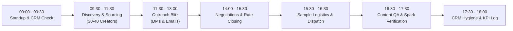

# FAIRYTALES SMM: INFLUENCER RELATIONSHIP MANAGER (IRM) OPERATIONAL HANDBOOK

**Position:** Influencer Relationship Manager (IRM) / Talent Acquisition Lead  
**Agency:** Fairytales SMM  
**Headquarters:** High Heath Farm, Whitwell Road, Codicote, Hertfordshire, SG4 8SZ  
**Reporting To:** Managing Partner (`fairytales_smm_director`)  
**Core Mission:** Scout, recruit, negotiate, onboard, and nurture an elite roster of 500+ TikTok and Instagram creators to deliver viral UGC, social commerce revenue, and high-converting paid ad assets for our in-house brands and external agency clients.

---

## 1. The IRM Daily Schedule & Task List (The 8-Hour Blueprint)

### 09:00 – 09:30: Daily Kickoff & Priority Setting
- Review CRM (ClickUp / SARAL / Airtable) for replies from overnight outreach.
- Check incoming WhatsApp, TikTok, and Instagram DMs.
- Attend the 15-minute agency morning standup with the Managing Partner.

### 09:30 – 11:30: Deep-Dive Discovery & Talent Sourcing
- Find **30 to 40 new qualified creators** across TikTok and Instagram matching active client briefs.
- Apply the **100-Point Vetting Scorecard** (Audience quality $> 80\%$, engagement $\ge 3.5\%$, clean audio, natural charisma).
- Input verified creator handles, emails, follower counts, and engagement stats into the CRM.

### 11:30 – 13:00: High-Impact Outreach Sprint
- Send personalized outreach to all 30–40 sourced creators.
- **Instagram**: Send direct message + reply to their latest Instagram Story (increases open rates by 300%).
- **TikTok**: Send DM + find email in bio and send targeted cold email.
- **TikTok Shop Affiliate Center**: Send 25 targeted collaboration invitations with customized pitches.

### 13:00 – 14:00: Lunch Break

### 14:00 – 15:30: Creator Communication, Negotiations & Agreement Closing
- Respond to replies within **15 minutes** (speed-to-lead is critical).
- Negotiate pricing using Fairytales SMM rate cards and performance bonuses (flat fee + affiliate rev-share).
- Issue digital Creator Collaboration Agreements via PandaDoc / DocuSign.
- Collect Spark Ads codes / Meta Partnership access agreements.

### 15:30 – 16:30: Sample Fulfillment Logistics
- Log confirmed creator shipping addresses, variant preferences, and phone numbers.
- Submit sample dispatch orders to the Codicote fulfillment hub / warehouse.
- Send tracked shipping confirmation details to creators via WhatsApp/Email.

### 16:30 – 17:30: Content QA & Spark Code Verification
- Review draft UGC videos uploaded by creators against the Creative Brief.
- Check lighting, safe zones (no text covered by TikTok buttons), and audio clarity.
- Verify that TikTok Spark Ads authorization codes are active for **365 days**.
- Verify compliance with UK Advertising Standards Authority (ASA) and US FTC disclosure (`#ad` or Paid Partnership label).

### 17:30 – 18:00: CRM Hygiene & Daily Performance Logging
- Update deal stages in CRM: *Sourced $\to$ Contacted $\to$ Negotiating $\to$ Sample Shipped $\to$ Video Approved $\to$ Paid*.
- Log daily KPIs against targets:
  - Fresh Creators Sourced: Target **35+**
  - Outreaches Sent: Target **35+**
  - Confirmed Collaborations / Samples Dispatched: Target **4 to 6 daily** (20–30 weekly)

---

## 2. How to Find Top-Performing Influencers on TikTok & Instagram

### Method 1: The Native TikTok Search Method
1. **Keyword Sourcing**: Search niche terms, e.g., `[category] unboxing`, `honest review [product]`, `tiktokmademebuyit home`, `amazon finds [niche]`.
2. **Filter by Relevance & Date**: Toggle filter to *"Videos from the last 3 months"* with *"Most Liked"*.
3. **The Recommended Rabbit Hole**: When you find a great creator, click the small dropdown arrow next to their "Follow" button to reveal TikTok’s algorithmically recommended similar creators.
4. **TikTok Shop Affiliate Center**: Go to Seller Center $\to$ Affiliate Creator Marketplace $\to$ Search by GMV generated, average video views, and target category.

### Method 2: The Instagram Reels & Explore Grid
1. **Audio Scraping**: Identify trending original audio used by micro-creators in your category. Click the audio link to view all creators who used it.
2. **Competitor Tagged Feed**: Go to direct competitor brand profiles $\to$ Click the "Tagged Photos/Reels" tab $\to$ Identify creators who already review similar products.
3. **Story Interactions**: Watch creators' stories and interact before pitching.

### Method 3: Software Sourcing Tools
- **Modash / HypeAuditor**: Filter by country (UK, Germany, France, US), minimum engagement rate ($> 3\%$), fake follower rate ($< 15\%$), and audience gender/age splits.
- **SARAL**: Automated creator discovery, CRM pipeline tracking, and one-click sample dispatch tracking.

---

## 3. The Fairytales SMM Creator Pitch: Why Influencers Will Join Us

When reaching out, **never treat creators like cheap ad space**. Present Fairytales SMM as their premier agency partner.

### The 5 Irresistible Creator Benefits:
1. **Consistent, Recurring Paid Work**: Unlike one-off brands that ghost creators, Fairytales SMM manages multiple enterprise clients and in-house brands. Top creators get monthly guaranteed retainers.
2. **Paid Ad Amplification (Spark Ads & Meta Partnership)**: We spend thousands boosting creator videos. This delivers **tens of thousands of free profile views and followers** directly to the creator's account.
3. **Premium Gifting & VIP Packaging**: Creators receive high-value curated gift packages dispatched from our High Heath Farm campus with personalized notes.
4. **High-Converting Affiliate Commissions**: In addition to base fees, creators earn 15%–20% uncapped commissions on TikTok Shop and DTC sales.
5. **Fairytales Creator VIP Club**: Fast payouts within 7–14 days, dedicated talent manager support, and invitations to filming days at our Codicote studio campus.

---

## 4. Key Rules, Red Flags & Creator Governance

### 🚩 Red Flags (Do NOT Work With):
- Engagement rate below 2.0% with sudden spikes (indicates purchased views or engagement pods).
- Comments consisting entirely of single emojis or bots (`"great pic"`, `"DM to collaborate"`).
- Refusal to sign contracts or refusal to provide 90-365 day Spark Ad authorization codes.
- Demanding 100% upfront payment before contract signature or product arrival.

### ⚖️ Legal & FTC/ASA Advertising Standards:
- All posts must clearly display `#ad` or use the platform's native `"Paid Partnership"` toggle before the fold (not buried in the middle of 30 hashtags).
- Creators cannot make false health, medical, or misleading performance claims that violate advertising standards.
